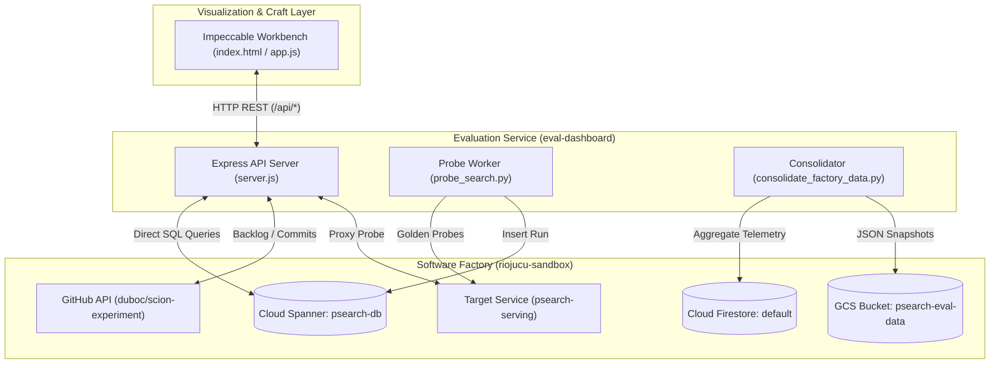

# `psearch-eval` — Product Requirements Document (PRD)

**Project:** `psearch-eval`  
**Role:** Control Tower, Search Quality Evaluation & Multi-Agent Factory Monitor  
**Target Backend:** `psearch-serving` (`riojucu-sandbox`)  
**Design Standard:** Impeccable Design System (`impeccable.style`) · Mode: *Operate* · World: *Precision Telemetry Ledger*  
**Harness:** Antigravity (100% agentic autonomous operations)  
**Reporting Line:** `@ui-craftsman` & `@search-evaluator` & `@factory-analyst` $\to$ `@eval-lead`  

---

## 1. Executive Summary & Vision

The **`psearch-eval`** platform is the real-time observability console, quality evaluation harness, and factory intelligence workbench for the **`psearch`** software factory. As `psearch` evolves across its multi-agent lifecycle (`lead`, `backend`, `frontend`, `reviewer`, `deployer`), `psearch-eval` provides continuous, empirical, zero-speculation verification of search relevance, low-latency performance, and compliance across all 10 Biggy Search backlog issues.

### Core Tenets
1. **Zero-Mock Empirical Evidence**: Never report hypothetical or hardcoded pass states. All NDCG@10, MRR@10, latency percentiles, and requirement statuses must originate from active Cloud Spanner `eval_runs`, live HTTP probes, or Firestore records.
2. **Sub-Second Factory Observability**: Provide instantaneous visibility into multi-agent factory status (`factory_agent_status`), active waves, turn counts, and git commit history across branches (`main` and `eval-dashboard`).
3. **Impeccable Ergonomics**: Adhere strictly to the Impeccable Design System principles: purposeful density, high contrast, tabular numerals, unnested hairline grid structures, and dual-mode (*Daylight* and *Carbon*) precision ledger interfaces.

---

## 2. Product Personas & Stakeholders

| Persona | Role | Key Jobs to be Done | Primary Interface Surface |
|---|---|---|---|
| **`@eval-lead`** | Evaluation Orchestrator & Factory Lead | Oversees end-to-end requirement compliance, triggers automated sweeps, resolves regressions | Executive Asymmetric Focal Strip, Compliance Ledger |
| **`@search-evaluator`** | Quantitative Relevance Engineer | Runs NDCG@10 / MRR@10 benchmark probes, measures optimal hybrid $\alpha$ parameter curves | Alpha Parameter Sweep SVG, Latency Percentile Ledger |
| **`@ui-craftsman`** | Impeccable Design & Visualization Engineer | Maintains interface aesthetics, ensures WCAG AA compliance, optimizes interactive data density | Interactive Workbench, Theme Engine, Component Library |
| **`@factory-analyst`** | Agentic Operations Specialist | Tracks agent turns, model invocations, phase transitions, and cross-agent dependency topology | Multi-Agent Topology Graph, Agent Status Inspector |
| **Search Product Manager** | Business & Merchandising Stakeholder | Validates business logic: delivery promises, merchandising boosts, out-of-stock sorting, synonyms | Interactive Hybrid RRF Query Workbench |

---

## 3. The 10 Biggy Search Functional Requirements (Backlog #1–#10)

The core evaluation suite monitors compliance against the 10 Biggy Search specifications outlined in Knowledge Plane ADRs #001–#006:

### 3.1 Issue #1: Dynamic Hybrid Search ($\alpha$-RRF Fusion) — Section 4.1.1
- **Specification:** Search requests must support dynamic weighting between lexical full-text search (BM25/FTS) and dense vector search (ScaNN embeddings) via reciprocal rank fusion (RRF) directly executed inside Cloud Spanner SQL:
  $$\text{Score}(d) = \alpha \cdot \text{RRF}_{\text{vector}}(d) + (1 - \alpha) \cdot \text{RRF}_{\text{text}}(d)$$
- **Acceptance Criteria:**
  - Query parameter `alpha` accepted in range $[0.00, 1.00]$ (default $\alpha = 0.65$).
  - Effective $\alpha$ mirrored in response payload metadata.
  - Returns combined ranking without client-side re-sorting.

### 3.2 Issue #2: Dense Vector Search (1024-dim, Blue/Green, Cache) — Section 4.1.2
- **Specification:** 1024-dimensional embeddings generated via Gemini (`text-embedding-004`). Two-tier caching (in-memory LRU + Cloud Spanner `embedding_cache` table) with blue/green version switching (`embedding_v1` $\leftrightarrow$ `embedding_v2`).
- **Acceptance Criteria:**
  - `GET /api/info` confirms active dimension `1024` and `active_embedding_version: v2`.
  - Repeat queries demonstrate cache hit with sub-10ms response times.
  - Spanner-backed vector distance searches run via Cosine Distance.

### 3.3 Issue #3: Inventory Availability & Demotion — Section 4.1.3
- **Specification:** Catalog search results must incorporate real-time stock levels and channel visibility. Items designated as `OUT_OF_STOCK` ($stock = 0$) must be strictly demoted to the final ranks of the result set rather than discarded.
- **Acceptance Criteria:**
  - `is_available` boolean and `stock` quantity present on every search result.
  - If a result set contains both `IN_STOCK` and `OUT_OF_STOCK` products, all `OUT_OF_STOCK` products appear after the last `IN_STOCK` product.

### 3.4 Issue #4: Multilingual & Multi-Tenant Partitioning — Section 4.1.4
- **Specification:** Strict locale isolation across Brazilian Portuguese (`pt-BR`), US English (`en-US`), and Mexican Spanish (`es-MX`) using composite indexing on `(tenant_id, locale, product_id)`.
- **Acceptance Criteria:**
  - Probing with `locale=pt-BR` returns 100% pt-BR catalog records; zero English or Spanish record bleed.
  - Localized tokenization and stemming applied transparently.

### 3.5 Issue #5: Server-Side Concurrent Facets — Section 4.1.5
- **Specification:** Aggregation of categories, brands, price tiers, and availability computed server-side across concurrent Go goroutines (`errgroup`) against Cloud Spanner.
- **Acceptance Criteria:**
  - Facet aggregation latency overhead $\le 15\text{ms}$.
  - Search response includes populated `facets` object containing `categories`, `brands`, `price_ranges`, and `availability`.

### 3.6 Issue #6: Merchandising Rules & 8 SQL Boost Signals — Section 4.1.6
- **Specification:** Composite relevance scoring incorporating 8 numerical merchandising boost signals:
  1. Rating ($1.0 - 5.0$)
  2. Margin percentage
  3. Review count
  4. Sales velocity
  5. Recency / creation timestamp
  6. CTR (Click-Through Rate)
  7. Rule-based multiplier ($\times 1.0 - 2.5$)
  8. Promotional campaign weight
- **Acceptance Criteria:**
  - `GET /api/rules` serves active merchandising campaign rules.
  - Product `score` object reflects `boost` and `rule_multiplier`.

### 3.7 Issue #7: Low-Relevance Synonyms (0.3x Weight) — Section 4.1.7
- **Specification:** Synonym expansion powered by Cloud Spanner `search_synonyms` table with a damped score multiplier ($0.3\times \text{SCORE}$) to prevent keyword hijacking and relevance degradation.
- **Acceptance Criteria:**
  - `GET /api/synonyms` returns configured synonym groups (e.g. *sneakers* $\leftrightarrow$ *running shoes*).
  - Expanded queries return synonym matches scored at discounted text weight.

### 3.8 Issue #8: Delivery Promises (CEP/SLA Routing) — Section 4.1.8
- **Specification:** SLA and freight calculation resolved via Cloud Spanner hierarchical table interleaving (`products` $\to$ `skus` $\to$ `regional_inventory` using `INTERLEAVE IN PARENT`).
- **Acceptance Criteria:**
  - Search requests accepting `cep=01310-100` return a `deliveryPromise` object detailing `region_code`, `cd_id`, `sla_hours`, `shipping_cost`, and customer promise label.

### 3.9 Issue #9: Intelligent Autocomplete (BigQuery + N-Grams) — Section 4.1.9
- **Specification:** Real-time search suggestions powered by BigQuery historical search telemetry and Spanner `TOKENIZE_NGRAMS` prefix/infix indexes.
- **Acceptance Criteria:**
  - `GET /api/autocomplete?q=run` responds in $\le 10\text{ms}$.
  - Returns suggestions with query frequency `search_count` and historical `ctr_score`.

### 3.10 Issue #10: Two-Stage Learning to Rank (LTR) — Section 4.1.10
- **Specification:** Hybrid search pipeline retrieves top-100 candidates from Cloud Spanner (Stage 1), followed by sub-2ms in-memory machine learning re-ranking in Go (Stage 2).
- **Acceptance Criteria:**
  - `ltr=true` flag activates Stage 2 in-memory re-ranker.
  - Result score metadata includes `ltr_score`, `stage1_rank`, `stage2_rank`, and `ltr_latency_us` ($\le 2000\mu\text{s}$).

---

## 4. Key Performance Indicators (KPIs) & Target SLAs

| Metric | Target SLA | Degraded Threshold | Breach / Failure |
|---|---|---|---|
| **NDCG@10** | $\ge 0.850$ | $0.700 - 0.849$ | $< 0.700$ |
| **MRR@10** | $\ge 0.900$ | $0.750 - 0.899$ | $< 0.750$ |
| **p50 Search Latency** | $\le 30.0\text{ms}$ | $30.1\text{ms} - 50.0\text{ms}$ | $> 50.0\text{ms}$ |
| **p95 Search Latency** | $\le 80.0\text{ms}$ | $80.1\text{ms} - 120.0\text{ms}$ | $> 120.0\text{ms}$ |
| **p99 Search Latency** | $\le 150.0\text{ms}$ | $150.1\text{ms} - 250.0\text{ms}$ | $> 250.0\text{ms}$ |
| **Optimal Hybrid $\alpha$** | $\alpha = 0.65$ | $\alpha \in [0.50, 0.75]$ | Out of range |
| **Requirement Pass Rate** | $10 / 10$ ($100\%$) | $8 - 9 / 10$ | $< 8 / 10$ |

---

## 5. System Architecture & Data Plane Integrations

### Storage Schema & Tables
1. **Cloud Spanner `eval_runs`**:
   - `run_id` (STRING, UUIDv4)
   - `git_commit` (STRING)
   - `overall_score` (FLOAT64)
   - `ndcg_at_10`, `mrr_at_10` (FLOAT64)
   - `p50_ms`, `p95_ms`, `p99_ms` (FLOAT64)
   - `requirements_json` (JSON containing requirement checks, alpha curve, diagnostics)
   - `created_at` (TIMESTAMP)
2. **Cloud Spanner `factory_agent_status`**:
   - `project_slug`, `agent_name`, `agent_id`, `template`, `harness`, `phase`, `activity`, `parent_agent`, `current_turns`, `model_calls`, `last_summary`, `updated_at`
3. **Cloud Firestore Collections**:
   - `eval_runs`, `requirements_compliance`, `agents`, `tasks`
4. **Google Cloud Storage (GCS)**:
   - `gs://psearch-eval-data-riojucu-sandbox/snapshots/eval-run-<timestamp>.json`

---

## 6. Workbench Ergonomics & Functional Capabilities

The `psearch-eval` workbench is structured into 4 primary operational zones:
1. **Asymmetric Focal Strip**: Immediate readouts of NDCG@10, MRR@10, SLA latency percentiles, and an inline SVG rendering the live $\alpha$-sweep relevance curve.
2. **Interactive Hybrid RRF Query Workbench**: Live parameter tuning bar allowing evaluators to execute ad-hoc searches against `psearch-serving` with customizable queries, dynamic $\alpha$, and locale selection, observing real-time rank demotions and scoring breakdown.
3. **10 Biggy Search Requirements Ledger**: Filterable compliance matrix (All / Wave 1 / Wave 2 / Wave 3) detailing status badges, code references, owner agents, measured latencies, and technical evidence.
4. **Multi-Agent Factory Topology & Telemetry**: Visual node graph of active factory agents (`lead`, `backend`, `frontend`, `reviewer`, `deployer`, `eval-lead`, `search-evaluator`, `ui-craftsman`), turn counters, model call tallies, and git commit history.
