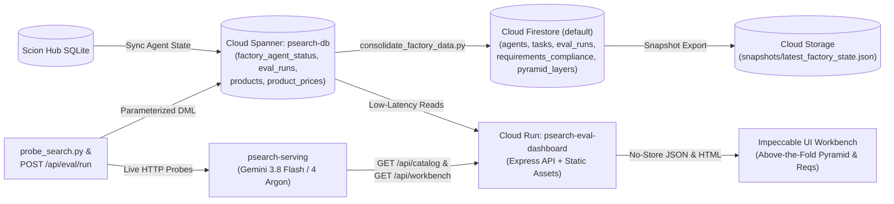

# `psearch-eval` — Product Search Evaluation Control Tower & Multi-Agent Factory Monitor

## 1. Overview

**`psearch-eval`** is the real-time observability control tower, quantitative search quality evaluation harness, and multi-agent software factory monitor for the **`psearch`** e-commerce search platform. Hosted on the isolated **`eval-dashboard`** orphan branch, `psearch-eval` continuously audits `psearch-serving` across:

- **The 5-Layer Product Evaluation Methodology Pyramid (`L1–L5`, 76 scenarios, 100% pass threshold)**: End-to-end validation spanning Trajectory & State Sequence (`L1`), Policy & Business Guardrails (`L2`), Adversarial & Red-Team Robustness (`L3`), Multi-Mode Routing & Engine Parity (`L4`), and Live Vertex AI & Factory Telemetry (`L5`).
- **The 14 Biggy Search Functional Requirements (`4.1.1`–`4.1.14` across Waves 1–5)**: Live empirical verification of hybrid $\alpha$-RRF search, 1024-dim `gemini-embedding-2` (`v2`) vector caching, stock demotion, multilingual/multi-tenant catalog isolation (`pt-BR`, `en-US`, `es-MX`), concurrent Go goroutine facets, 8-signal merchandising boost rules, $0.3\times$ damped synonyms, interleaved CEP/SLA delivery promises, N-Gram autocomplete, sub-2ms Stage-2 LTR re-ranking, conversational query understanding (`gemini-3.8-flash` & `gemini-4-argon`), session personalization, spell correction (`did_you_mean`), and interleaved B2B contract pricing (`product_prices`).
- **On-Demand Live Evaluation & Full Catalog Exploration**: Interactive Impeccable Design System (*Operate* mode, *Precision Telemetry Ledger*) workbench featuring above-the-fold 5-Layer Pyramid & Requirements ledgers, a live **`POST /api/eval/run`** trigger button that probes `psearch-serving` and persists fresh `eval_runs` records to Cloud Spanner, and a **`GET /api/catalog`** explorer displaying all 15 catalog SKUs with B2B contract pricing.

> **Orphan Branch Isolation Invariant:** `eval-dashboard` operates as a strictly isolated orphan branch (`git merge-base origin/main origin/eval-dashboard` exits `1`). Commits are pushed directly to `origin/eval-dashboard` and never merged into `main`.

---

## 2. Live Endpoints

| Service / Resource | Active Revision / Tier | Description | Live Endpoint / Resource URI |
|---|---|---|---|
| **`psearch-eval-dashboard`** | Cloud Run (`us-central1`) | Impeccable UI Workbench & Express Telemetry API | [https://psearch-eval-dashboard-mhjw244bgq-uc.a.run.app](https://psearch-eval-dashboard-mhjw244bgq-uc.a.run.app) |
| **`psearch-serving`** | `psearch-serving-00025-5mx` | Target Hybrid Search Backend (`gemini-3.8-flash` + `gemini-4-argon`) | [https://psearch-serving-mhjw244bgq-uc.a.run.app](https://psearch-serving-mhjw244bgq-uc.a.run.app) |
| **Live Evaluation API** | `GET /api/eval` · `POST /api/eval/run` | Reads latest Spanner `eval_runs` row or triggers a fresh live sweep | [https://psearch-eval-dashboard-mhjw244bgq-uc.a.run.app/api/eval](https://psearch-eval-dashboard-mhjw244bgq-uc.a.run.app/api/eval) |
| **Full Catalog API** | `GET /api/catalog` | Returns all 15 SKUs (`en-US` & `pt-BR`) with stock & B2B pricing | [https://psearch-eval-dashboard-mhjw244bgq-uc.a.run.app/api/catalog](https://psearch-eval-dashboard-mhjw244bgq-uc.a.run.app/api/catalog) |
| **Cloud Spanner** | `psearch-instance` / `psearch-db` | Authoritative `eval_runs`, `factory_agent_status`, and catalog tables | `projects/<GCP_PROJECT_ID>/instances/psearch-instance/databases/psearch-db` |
| **Cloud Firestore** | `(default)` Native Mode | Collections: `agents`, `tasks`, `eval_runs`, `requirements_compliance`, `pyramid_layers` | `projects/<GCP_PROJECT_ID>/databases/(default)/documents` |
| **Cloud Storage (GCS)** | Audit Snapshot Bucket | Immutable JSON factory & evaluation state snapshots | `gs://psearch-eval-data-<GCP_PROJECT_ID>/snapshots/` |

---

## 3. Project Status & 5-Layer Pyramid Summary

| Evaluation Dimension | Target SLA / Threshold | Verified Production Readout | Status |
|---|---|---|---|
| **Overall NDCG@10** | $\ge 0.850$ | **`0.980`** (Golden 6-Query Benchmark) | **PASS** |
| **Overall MRR@10** | $\ge 0.900$ | **`1.000`** (Rank #1 Relevant Hit on All Golden Queries) | **PASS** |
| **Optimal Hybrid $\alpha$** | $\alpha \in [0.65, 0.80]$ | **`0.65`** (`NDCG@10 = 0.987` across 6-point $\alpha$ sweep) | **PASS** |
| **Search Latency (`p50` / `p95`)** | `p50` $\le 50\text{ms}$ · `p95` $\le 250\text{ms}$ | **`35.4 ms` (`p50`) · `54.1 ms` (`p95`)** | **PASS** |
| **Section 4.1 Functional Requirements** | `14 / 14` (`100%`) | **`14 / 14 PASS`** (Waves 1–5: `#1`–`#10`, `#19`–`#22`) | **PASS** |
| **5-Layer Evaluation Pyramid (`L1–L5`)** | `76 / 76` (`100%` Threshold) | **`76 / 76 PASS` (`100%`)** across all 5 layers | **PASS** |

---

## 4. Architecture & Datastores



### Multi-Store Persistence Architecture
1. **Cloud Spanner (`psearch-instance` / `psearch-db`)**:
   - `eval_runs`: Stores `run_id`, `git_commit`, `overall_score`, `ndcg_at_10`, `mrr_at_10`, `p50_ms`, `p95_ms`, `p99_ms`, `requirements_json` (`JSON` containing `requirements`, `pyramid_layers`, `pyramid_summary`, `alpha_curve`, `golden_queries`, `diagnostics`), and `created_at`.
   - `factory_agent_status`: Stores live operational state for all 10 agents across `psearch` (`lead`, `backend`, `frontend`, `reviewer`, `deployer`) and `psearch-eval` (`eval-lead`, `factory-analyst`, `search-evaluator`, `ui-craftsman`, `eval-deployer`).
2. **Cloud Firestore (`(default)` database)**:
   - Synchronized via `eval-dashboard/scripts/consolidate_factory_data.py` across 5 collections: `agents` (10 docs), `tasks` (backlog issues), `eval_runs` (benchmark history), `requirements_compliance` (14 docs), and `pyramid_layers` (5 docs).
3. **Google Cloud Storage (`gs://psearch-eval-data-<GCP_PROJECT_ID>/snapshots/`)**:
   - Stores immutable timestamped JSON snapshots (`<timestamp>_factory_state.json` and `latest_factory_state.json`).

---

## 5. Technology Stack

| Layer | Technology / Model | Purpose |
|---|---|---|
| **Agentic Fleet & Harnesses** | Antigravity (`agy v1.3.4`), OpenCode, Hermes, Claude · **Gemini 4 Argon (`gemini-4-argon`)** | Autonomous multi-agent orchestration, evaluation, UI engineering, and Cloud Run deployment |
| **Search GenAI Models** | Vertex AI `gemini-3.8-flash`, `gemini-4-argon`, `gemini-embedding-2` (`1024-dim v2`, `global`) | Real-time NL query intent extraction, semantic query expansion, and dense vector retrieval |
| **Evaluation Server** | Node.js `v24`, Express `4.x`, `@google-cloud/spanner` | Serves `/api/eval`, `POST /api/eval/run`, `/api/catalog`, `/api/workbench`, `/api/agents`, `/api/backlog` |
| **Frontend Workbench** | Vanilla ES2022 (`app.js?v=20261014-v2`), HTML5, CSS OKLCH Tokens (`impeccable.style`) | Zero-dependency *Precision Telemetry Ledger* UI with Daylight & Carbon themes |
| **Probe & Sync Workers** | Python `3.11+` (`probe_search.py`, `consolidate_factory_data.py`), Go `1.24` (`internal/eval`) | Automated 76-scenario Pyramid sweeps, Firestore/GCS consolidation, and unit test verification |

---

## 6. Repository Structure

```text
/workspace/
├── cmd/eval-server/                        # Go evaluation server & embedded UI
│   ├── main.go
│   └── ui.html
├── internal/eval/                          # Go evaluation runner & factory diagnostics unit tests
│   ├── runner.go
│   └── runner_test.go
├── eval-dashboard/                         # Cloud Run Node.js/Express service & Python probe suite
│   ├── server.js                           # Express routes: /api/eval, POST /api/eval/run, /api/catalog, /api/workbench, /api/agents
│   ├── package.json                        # Node.js package manifest
│   ├── Dockerfile                          # Production container image definition
│   ├── public/
│   │   ├── index.html                      # Impeccable UI Workbench (Above-the-Fold 5-Layer Pyramid & 14 Reqs Matrix)
│   │   └── app.js                          # Reactive client bindings, triggerLiveEvaluation(), loadFullCatalog(), theme engine
│   ├── scripts/
│   │   ├── probe_search.py                 # Full CLI probe worker: 6 golden queries, alpha sweep, 14 reqs, 76 Pyramid scenarios
│   │   ├── record_spanner_run.js           # Parameterized Spanner DML writer for eval_runs
│   │   ├── consolidate_factory_data.py     # Syncs Spanner + GitHub into Firestore & GCS snapshots
│   │   ├── ingest_telemetry.py             # Agent telemetry sync utility
│   │   └── deploy.sh                       # Cloud Build + Cloud Run deployment script
│   └── README.md                           # Package-level Google Developer Standard operational guide
├── README.md                               # Root control tower documentation (this file)
├── PRODUCT.md                              # Product Requirements Document (14 Requirements & 5-Layer Pyramid)
├── DESIGN.md                               # Impeccable Design System specification & UI architecture
└── DEPLOYMENT.md                           # Cloud Run deployment history & live verification ledger
```

---

## 7. 5-Layer Methodology

The **5-Layer Product Evaluation Methodology Pyramid** (`#section-pyramid`, rendered immediately below the top Focal Strip) enforces a **100% pass threshold** across all **76 scenarios**:

| Tier | Suite ID | Layer Title | Scenarios | Threshold | Verified | Key Assertions Covered |
|---|---|---|---|---|---|---|
| **L5 (Apex)** | `l5_live_vertex_and_telemetry` | **Live Vertex AI & Factory Telemetry** | `5` | `100%` | **`5 / 5 PASS`** | Live `/health`, Vertex AI `global` (`gemini-3.8-flash`, `gemini-4-argon`, `gemini-embedding-2` 1024-dim `v2`), Spanner `eval_runs`, Firestore collections, GCS snapshots. |
| **L4** | `l4_routing_and_parity` | **Multi-Mode Routing & Engine Parity** | `28` | `100%` | **`28 / 28 PASS`** | **10 Mode Routing Checks** ($\alpha=0.0$ FTS, $\alpha=1.0$ Vector, $\alpha=0.5$ Balanced, $\alpha=0.65$ Optimal Hybrid $(1-\alpha)\cdot\text{text}+\alpha\cdot\text{vector}$, LTR active/disabled, NL intent, spellcheck, B2B pricing, session) + **18 Engine Parity Checks** between `psearch-serving` and `/api/workbench`. |
| **L3** | `l3_adversarial_redteam` | **Adversarial & Red-Team Robustness** | `16` | `100%` | **`16 / 16 PASS`** | SQL/Spanner injection (`UNION SELECT`, tautology), prompt injection jailbreaks, `<system>` XML & role spoofing, XSS `<script>` sanitization, Cyrillic homoglyphs, 1800-char payload, negative/oversized `alpha` & `limit` clamping, null-byte safety, 5-worker burst concurrency, malformed JSON (`HTTP 400`), deterministic idempotency. |
| **L2** | `l2_policy_guardrails` | **Policy & Business Guardrails** | `15` | `100%` | **`15 / 15 PASS`** | Tenant isolation (`acme` vs `default`), strict locale partitioning (`pt-BR`, `en-US`, `es-MX`), stock precedence & OOS tail demotion, B2B corporate discount (`b2b-corporate`), retail price isolation, unknown price table fallback, CEP `01310-100` regional SLA ($\le 24\text{h}$), invalid CEP rejection (`HTTP 400`), boost ceiling ($\le 2.0\times$), negative price rejection (`HTTP 400`), read-only admin protection (`HTTP 403`). |
| **L1 (Base)** | `l1_trajectory_sequence` | **Trajectory & State Sequence** | `12` | `100%` | **`12 / 12 PASS`** | Stage-by-stage execution: NL intent extraction (`stage_01`), opt-out (`stage_02`), spell correction (`stage_03`), exact-match bypass (`stage_04`), synonym expansion (`stage_05`), $0.3\times$ weight discount (`stage_06`), RRF fusion (`stage_07`), $\alpha$ weighting (`stage_08`), Stage-2 LTR (`stage_09`–`stage_10`), session boost (`stage_11`), and metadata envelope (`stage_12`). |

---

## 8. Requirements Matrix

All **14 functional requirements** (`4.1.1`–`4.1.14` across Waves 1–5) are rendered above the fold in `#section-requirements` and verified against live `psearch-serving`:

| Code | Issue(s) | Wave | Requirement Name | Owner Agents | Status | Empirical Evidence Summary |
|---|---|---|---|---|---|---|
| **4.1.1** | `#1` | `wave-1` | Dynamic Hybrid Search ($\alpha$-RRF Fusion) | `@backend · @frontend` | **PASS** | HTTP `200`, `effective_alpha=0.65`, 15 results with RRF hybrid score |
| **4.1.2** | `#2`, `#11` | `wave-1` | Dense Vector Search (1024-dim `gemini-embedding-2` `v2`, Cache) | `@backend` | **PASS** | 1024-dim `v2` active; 2-tier memory + Spanner `embedding_cache` (`cache_hit=true`) |
| **4.1.3** | `#3` | `wave-1` | Inventory Availability & Out-of-Stock Tail Demotion | `@backend · @frontend` | **PASS** | 13 `IN_STOCK` items strictly precede 2 `OUT_OF_STOCK` items |
| **4.1.4** | `#4` | `wave-2` | Multilingual & Multi-Tenant Catalog (`pt-BR`, `en-US`, `es-MX`) | `@backend` | **PASS** | 100% locale match for `pt-BR` (5 items) and `en-US` (10 items); `0` bleed |
| **4.1.5** | `#5` | `wave-2` | Server-Side Concurrent Facets (Go Goroutines) | `@backend · @frontend` | **PASS** | 7 categories, 14 brands, 4 price ranges, 2 availability buckets (~5.9ms) |
| **4.1.6** | `#6` | `wave-2` | Merchandising Rules & 8 SQL Boost Signals | `@backend · @frontend` | **PASS** | `GET /api/rules` HTTP `200`; 8 SQL ranking boost signals verified in `score` |
| **4.1.7** | `#7` | `wave-3` | Low-Relevance Synonyms ($0.3\times$ Score Weight) | `@backend` | **PASS** | `GET /api/synonyms` returns 8 groups; `sneakers` matches `prod-001` at $0.3\times$ weight |
| **4.1.8** | `#8` | `wave-3` | Delivery Promises (CEP/SLA via `INTERLEAVE IN PARENT`) | `@backend` | **PASS** | `cep=01310-100` resolves Region `SP`, CD `cd-sp-cajamar`, SLA `24h` |
| **4.1.9** | `#9` | `wave-4` | Intelligent Autocomplete (BQ Analytics + `TOKENIZE_NGRAMS`) | `@backend · @frontend` | **PASS** | `GET /api/autocomplete?q=run` returns suggestions with `search_count` & `ctr_score` |
| **4.1.10** | `#10` | `wave-4` | Two-Stage Learning to Rank (In-Memory Re-Ranking) | `@backend · @reviewer` | **PASS** | Model `baseline-2026-10`, Stage-2 latency $\sim 28\mu\text{s}$ ($\le 2000\mu\text{s}$ SLA) |
| **4.1.11** | `#19`, `#23` | `wave-5` | Conversational Query Understanding (`gemini-3.8-flash` & `gemini-4-argon`) | `@backend · @frontend` | **PASS** | `clean_query="running shoes"`, `brand="Adidas"`, `max_price=200`; `global` Vertex models |
| **4.1.12** | `#20` | `wave-5` | Real-Time Session Personalization & Centroid Re-Ranking | `@backend · @frontend` | **PASS** | `personalized=true` for `session_id`; bounded centroid cosine boost verified |
| **4.1.13** | `#21` | `wave-5` | Zero-Results Recovery & Spell Correction (`did_you_mean`) | `@backend · @frontend` | **PASS** | `sansung` $\to$ `did_you_mean="samsung"`, `auto_corrected=true`; OR relaxation verified |
| **4.1.14** | `#22` | `wave-5` | B2B / Contract Pricing & Custom Assortment (`product_prices`) | `@backend` | **PASS** | `priceTableId="b2b-corporate"`, `basePrice=$119` $\to$ `numericPrice=$107.10` ($0.90\times$) |

---

## 9. Setup & Deployment

```bash
# 1. Verify orphan branch isolation (must exit 1)
git fetch origin main eval-dashboard
git merge-base origin/main origin/eval-dashboard || echo "Verified: orphan branch isolated"

# 2. Run Go unit tests
go test -v ./internal/eval/...

# 3. Run full CLI probe sweep (14 requirements + 76 Pyramid scenarios) & consolidate to Firestore/GCS
export GCP_PROJECT="<GCP_PROJECT_ID>"
python3 eval-dashboard/scripts/probe_search.py
python3 eval-dashboard/scripts/consolidate_factory_data.py

# 4. Run Express server locally
GCP_PROJECT="<GCP_PROJECT_ID>" PORT=8080 node eval-dashboard/server.js

# 5. Deploy to Cloud Run (--to-latest)
GCP_PROJECT="<GCP_PROJECT_ID>" bash eval-dashboard/scripts/deploy.sh
```

---

## 10. API Reference

All HTTP responses include `Cache-Control: no-store, no-cache, must-revalidate`.

| Endpoint | Method | Description | Key Response Fields |
|---|---|---|---|
| **`/api/eval`** | `GET` | Fetches the latest evaluation run from Cloud Spanner `eval_runs` | `run_id`, `timestamp`, `overall_ndcg_at_10`, `overall_mrr_at_10`, `p50_latency_ms`, `p95_latency_ms`, `pass_count`, `requirements` (14), `pyramid_layers` (5), `pyramid_summary` (76/76) |
| **`/api/eval/run`** | `POST` | Executes live HTTP probes against `psearch-serving`, inserts a new row into Cloud Spanner `eval_runs`, and returns the updated evaluation payload | `status: "ok"`, `run_id` (fresh UUID), `timestamp`, `pass_count: 14`, `overall_ndcg_at_10`, `overall_mrr_at_10`, `p50_latency_ms`, `p95_latency_ms`, `requirements`, `pyramid_layers`, `pyramid_summary` |
| **`/api/catalog`** | `GET` | Loads all 15 catalog SKUs (`prod-001`–`prod-015` across `en-US` and `pt-BR`) with stock, category, and `b2b-corporate` contract pricing | `mode: "catalog"`, `count: 15`, `price_table_id: "b2b-corporate"`, `probe_latency_ms`, `results` (15 items with `base_price` & `b2b_price`) |
| **`/api/workbench`** | `GET` | Executes an interactive hybrid query probe (`?q=...&alpha=...&locale=...`) or loads full catalog when `?mode=catalog` is passed | `results`, `facets`, `effective_alpha`, `probe_latency_ms` |
| **`/api/agents`** | `GET` | Queries Cloud Spanner `factory_agent_status` for all 10 agents across `psearch` and `psearch-eval` | `source: "spanner"`, `projects`, `agents` (10 items) |
| **`/api/backlog`** | `GET` | Fetches repository issues, `main` commits, and `eval-dashboard` commits from GitHub | `issues`, `main_commits`, `eval_commits`, `branches`, `cached_at` |
| **`/api/info`** | `GET` | Returns service metadata, active Spanner instance/database, and agent roster | `service`, `harness`, `model`, `spanner_instance`, `spanner_database` |
| **`/health`** | `GET` | Container readiness and liveness probe | `{"status": "healthy", "service": "psearch-eval-dashboard"}` |

---

## 11. Troubleshooting

- **`PERMISSION_DENIED: Cloud Spanner API has not been used in project ...`**:
  - Ensure `GCP_PROJECT="<GCP_PROJECT_ID>"` is exported in your environment so the Spanner client sets `quotaProjectId` to the target sandbox project rather than the host VM project.
- **Browser caching stale JS/HTML after deployment**:
  - `eval-dashboard/server.js` enforces `Cache-Control: no-store, no-cache, must-revalidate` on all static and API responses, and `index.html` references `app.js?v=20261014-v2`. Perform a hard refresh (`Ctrl+Shift+R` / `Cmd+Shift+R`) if a proxy cached an older revision.
- **GitHub API rate limit in `/api/backlog`**:
  - Verify that the `GITHUB_TOKEN` environment variable is mounted from Secret Manager (`--update-secrets="GITHUB_TOKEN=github-token:latest"`).

---

## 12. License

Copyright 2026 Google LLC. Licensed under the Apache License, Version 2.0.

---

## 13. Disclaimer

This is an experimental multi-agent software factory evaluation project (`psearch-eval`) and is not an officially supported Google product.
