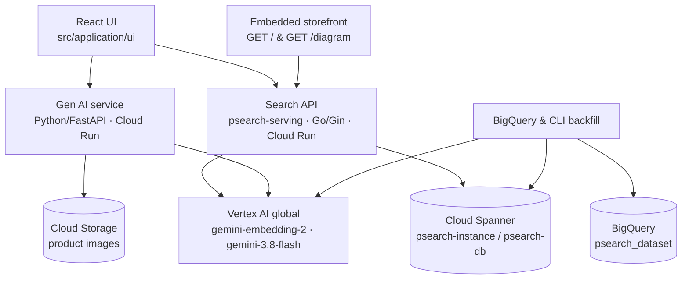

# PSearch enterprise product search platform

PSearch is an enterprise product search platform built on Google Cloud.
This document follows the Google Developer documentation style and the ASD-STE100 Simplified Technical English standard.

> [!IMPORTANT]
> Do not commit real project IDs, service URLs, or secret tokens to this repository.
> Replace placeholders such as `PROJECT_ID`, `SERVICE_URL`, and `ADMIN_TOKEN` with your environment values.

## Overview

PSearch executes hybrid vector and full-text product search directly in Cloud Spanner.
It combines Reciprocal Rank Fusion (RRF), ScaNN approximate nearest neighbor (ANN) search, and Vertex AI Gemini models in a single serving pipeline.

Key platform capabilities include:

- **Cloud Spanner hybrid search:** Fuses vector similarity and full-text `SEARCH()` scores with RRF in one SQL query.
- **ScaNN vector index:** Uses `APPROX_COSINE_DISTANCE` on 1024-dimension `gemini-embedding-2` vectors with automatic fallback to exact cosine distance.
- **Multi-stage ranking:** Applies merchandising rules, 8 business signals, Stage-2 Learning to Rank (LTR), and session centroid personalization.
- **Disjunctive and dynamic facets:** Computes exclude-own-dimension facet counts and auto-discovers vertical-specific attributes from an interleaved table.
- **Commerce and retail media:** Supports B2B contract price tables, postal code (CEP) delivery promises, item substitutes, and CPC sponsored products.
- **Closed-loop telemetry:** Tracks search impressions (`query_id`), click and purchase attribution, A/B experiment KPIs, and idempotent Bayesian signal rollups.

See [`DEPLOYMENT.md`](DEPLOYMENT.md) for the current Cloud Run revision.
To find your deployed service URL, run the following command:

```bash
gcloud run services describe psearch-serving \
  --project=PROJECT_ID \
  --region=us-central1 \
  --format='value(status.url)'
```

## Architecture

PSearch consists of four runtime components and three data stores on Google Cloud:



### Core components

- **Search API (`src/psearch/serving/`):** A Go and Gin service that serves `/api/search`, the embedded storefront (`GET /`), and the interactive architecture diagram (`GET /diagram`). It includes three CLI entrypoints: `cmd/server`, `cmd/sqlcheck`, and `cmd/backfill-embeddings`.
- **React UI (`src/application/ui/`):** A React 19 storefront and administration console. For setup instructions, see [`src/application/ui/README.md`](src/application/ui/README.md).
- **Gen AI service (`src/psearch/gen_ai/`):** A FastAPI service that generates product descriptions, marketing copy, enhanced product images, and SQL fixes.
- **Cloud Spanner (`psearch-db`):** The primary database that stores products, ScaNN vector indexes, full-text tokenlists, interleaved SKUs, prices, attributes, campaigns, and telemetry.

### Complete feature matrix

All capabilities across Waves 1 through 6 and recent platform updates (`#1`–`#48`, `#51`–`#52`, and `#54`, plus migrations `011`–`027`) are active.
For full architectural decisions, see [`knowledge-plane/INDEX.md`](knowledge-plane/INDEX.md).

| Feature | Issue(s) | ADR | Endpoint / parameter |
|---|---|---|---|
| Hybrid RRF search with tunable `alpha` | `#1` | [ADR-001](knowledge-plane/adr/ADR-001-hybrid-and-vector-1024.md) | `GET/POST /api/search` (`q`, `alpha`, `min_score`) |
| 1024-d `gemini-embedding-2` vectors, Blue/Green switch, and 2-tier embedding cache (`011`, `013`) | `#2`, `#11`, `#23` | [ADR-001](knowledge-plane/adr/ADR-001-hybrid-and-vector-1024.md) | `GET/POST /api/config/embedding-version`, `ACTIVE_EMBEDDING_VERSION` |
| Availability, visibility, sales channels, and out-of-stock last ordering (`012`) | `#3` | [ADR-002](knowledge-plane/adr/ADR-002-catalog-locale-avail.md) | `/api/search` (`only_in_stock`, `channel`) |
| Multi-tenant, multi-language catalog (`pt-BR`, `en-US`, `es-MX`) and accent folding (`014`, `014b`) | `#4` | [ADR-002](knowledge-plane/adr/ADR-002-catalog-locale-avail.md) | `/api/search` (`tenant_id`, `locale`), `TEXT_FOLDING` |
| Catalog browse (`q=*` or empty query) and embedded storefront | `#30` | [ADR-002](knowledge-plane/adr/ADR-002-catalog-locale-avail.md) | `GET /`, `GET /api/search?q=*` |
| Concurrent server-side facet counts and clickable storefront facets | `#5`, `#34`, `#38` | [ADR-003](knowledge-plane/adr/ADR-003-facets-and-synonyms.md) | `/api/search` (`facets` response, `category`, `brand`) |
| Low-weight synonym expansion and admin synonym upsert (`015`, `015b`) | `#7` | [ADR-003](knowledge-plane/adr/ADR-003-facets-and-synonyms.md) | `GET/POST /api/synonyms` |
| Merchandising rules (pin, bury, brand/category boost) and 8 business-signal boosts (`016`, `016b`) | `#6` | [ADR-004](knowledge-plane/adr/ADR-004-merchandising-boosts.md) | `GET/POST/PUT/DELETE /api/rules`, `BOOST_WEIGHT` |
| Regional CEP delivery promises over interleaved `skus` and `regional_inventory` (`017`–`017c`) | `#8` | [ADR-005](knowledge-plane/adr/ADR-005-delivery-promises.md) | `/api/search` (`cep`, `max_sla_hours`, `deliveryPromise`) |
| `SEARCH_NGRAMS` and prefix autocomplete suggestions (`018`, `018b`) | `#9` | [ADR-006](knowledge-plane/adr/ADR-006-autocomplete-and-ltr.md) | `GET /api/autocomplete` (`q`, `locale`, `tenant_id`, `limit`) |
| Two-stage in-memory Learning to Rank (LTR) over top candidates | `#10` | [ADR-006](knowledge-plane/adr/ADR-006-autocomplete-and-ltr.md) | `/api/search` (`ltr=true`), `LTR_MODEL_JSON` |
| Conversational query intent parser with Gemini Flash fallback (`020`) | `#19` | [ADR-007](knowledge-plane/adr/ADR-007-conversational-query-and-session.md) | `/api/search` (`parse_intent`, `parsed_query`), `INTENT_LLM_FALLBACK` |
| Session-aware centroid personalization (`021`) | `#20` | [ADR-007](knowledge-plane/adr/ADR-007-conversational-query-and-session.md) | `GET/POST /api/session/events`, `/api/search` (`session_id`, `session_product_ids`) |
| Zero-results recovery with `SEARCH_NGRAMS` spell check and `OR` relaxation | `#21` | [ADR-008](knowledge-plane/adr/ADR-008-zero-results-and-b2b-pricing.md) | `/api/search` (`did_you_mean`, `auto_corrected`, `query_relaxed`) |
| Interleaved B2B contract price tables and exclusive assortment (`019`, `019b`) | `#22` | [ADR-008](knowledge-plane/adr/ADR-008-zero-results-and-b2b-pricing.md) | `/api/search` (`price_table_id`, `min_price`, `max_price`) |
| Parent-SKU variant collapse with child color and size `EXISTS` filtering (`022`–`022c`) | `#32` | [ADR-009](knowledge-plane/adr/ADR-009-variant-grouping.md) | `/api/search` (`color`, `size`, `variants`, `available_colors`, `available_sizes`) |
| Visual and multimodal search (inline query photo + text refinement) | `#33` | [ADR-010](knowledge-plane/adr/ADR-010-visual-multimodal-search.md) | `POST /api/search` (`image_base64`, `image_mime_type`, `image_weight`) |
| Sponsored products auction with ACID CPC budget burn and click idempotency (`023`, `023b`) | `#35` | [ADR-011](knowledge-plane/adr/ADR-011-sponsored-products.md) | `GET/POST/PUT/DELETE /api/ads/campaigns`, `POST /api/ads/click`, `/api/search` (`ads`) |
| ScaNN ANN `VECTOR INDEX` (`APPROX_COSINE_DISTANCE`), exact fallback, and chunked backfill (`024`) | `#39` | [ADR-012](knowledge-plane/adr/ADR-012-scann-ann-and-pagination.md) | `/api/search` & `/api/info` (`vector_index_used`), `cmd/backfill-embeddings` |
| Fixed-window pagination (`W`), accurate `total_found`, and 5 `sort_by` modes | `#40` | [ADR-012](knowledge-plane/adr/ADR-012-scann-ann-and-pagination.md) | `/api/search` (`page`, `offset`, `limit`, `sort_by=relevance\|price_asc\|price_desc\|popularity\|rating_desc`) |
| Disjunctive multi-select faceting (`OR` within dimension, exclude-own-dimension counts) | `#41` | [ADR-013](knowledge-plane/adr/ADR-013-disjunctive-facets.md) | `/api/search` (`categories`, `brands`, `colors`, `sizes`, `price_ranges`) |
| Dynamic schema-free product attributes (`product_attributes`) and auto-discovered facets (`025`, `025b`) | `#42` | [ADR-014](knowledge-plane/adr/ADR-014-dynamic-product-attributes.md) | `/api/search` (`attr.<name>`, `attrs`, `facets.attributes`), `PUT /api/products/:id/attributes` |
| Closed-loop search telemetry (`query_id`), click/conversion attribution, and A/B KPIs (`026`) | `#43` | [ADR-015](knowledge-plane/adr/ADR-015-search-telemetry-and-attribution.md) | `/api/search` (`experiment_id`, `query_id`), `POST /api/analytics/events`, `GET /api/analytics/summary` |
| Item-to-item vector similarity, in-stock substitutes, and session co-visitation | `#44` | [ADR-016](knowledge-plane/adr/ADR-016-similar-items-and-substitutes.md) | `GET /api/products/:id/similar` (`mode=similar\|substitutes\|co_viewed`, `limit`) |
| Out-of-stock reachability in unfiltered hybrid search (relevance before `LIMIT`, OOS-last over `W`) | `#45` | [ADR-002](knowledge-plane/adr/ADR-002-catalog-locale-avail.md), [ADR-012](knowledge-plane/adr/ADR-012-scann-ann-and-pagination.md) | `GET/POST /api/search` |
| Two-stage count latency optimization (`LIMIT 501` capped count, canonical count cache, Go SQL specialization) | `#46` | [ADR-012](knowledge-plane/adr/ADR-012-scann-ann-and-pagination.md) | `GET/POST /api/search`, `cmd/sqlcheck` |
| Idempotent Bayesian prior-blended signal rollup over a frozen baseline (`027`) | `#47` | [ADR-015](knowledge-plane/adr/ADR-015-search-telemetry-and-attribution.md) | `POST /api/analytics/rollup` (`dry_run`, `prior_weight` / `k`, `window_days`) |
| Google Developer style and ASD-STE100 documentation | `#28`, `#29`, `#31`, `#48`, `#54` | — | `README.md`, `docs/USAGE.md`, `src/application/ui/README.md`, `tooling/*/README.md` |
| Interactive cloud architecture diagram | `#51` | — | `GET /diagram` |
| Public-repo identifier redaction, Spanner `PROJECT_ID` fail-fast validation, and `FORBIDDEN_ID_PATTERN` guard | `#52` | — | `GET /api/info` (`sandbox` = environment name), `PROJECT_ID`, `FORBIDDEN_ID_PATTERN` |
| 5-layer evaluation pyramid (`L1`–`L5`) and FinOps observability workbench (`psearch-eval-dashboard`) | `#18`, `#26`, `#36`, `#37` | — | [`docs/scion/verification-and-eval.md`](docs/scion/verification-and-eval.md) |

## Before you begin

Install the following tools on your workstation:

1. Install Go 1.26 or later.
2. Install Node.js 20 or later and npm (for the React UI).
3. Install Python 3.11 or later (for the Gen AI service and tooling).
4. Install the Google Cloud CLI (`gcloud`) and Terraform (for cloud deployments).

## Quickstart

You can run the Search API and embedded storefront locally in memory mode without a Google Cloud project.

1. Go to the serving directory:

   ```bash
   cd src/psearch/serving
   ```

2. Start the server in memory mode:

   ```bash
   USE_MEMORY_STORE=true go run ./cmd/server
   ```

3. Open `http://localhost:8080/` in your browser for the storefront, `http://localhost:8080/diagram` for the architecture diagram, or query the API:

   ```bash
   curl -s "http://localhost:8080/api/search?q=running+shoes&limit=5" | jq .
   ```

4. Run the unit and race test suite:

   ```bash
   go vet ./... && go test -race ./...
   ```

To start the React UI locally, follow the instructions in [`src/application/ui/README.md`](src/application/ui/README.md).

## Configure the service

The Search API reads its configuration from environment variables (`src/psearch/serving/internal/config/config.go`).

| Variable | Default | Description |
|---|---|---|
| `PORT` | `8080` | HTTP listen port for the server. |
| `ENVIRONMENT` | `production` | Deployment environment name (also reported in `/api/info` `sandbox`). |
| `PROJECT_ID` | `""` | Google Cloud project ID (falls back to `GCP_SANDBOX_PROJECT` or `CLOUDSDK_CORE_PROJECT`; required when `USE_MEMORY_STORE=false`). |
| `REGION` | `us-central1` | Google Cloud region for Cloud Run and Spanner. |
| `SPANNER_INSTANCE_ID` | `psearch-instance` | Cloud Spanner instance ID. |
| `SPANNER_DATABASE_ID` | `psearch-db` | Cloud Spanner database ID. |
| `USE_MEMORY_STORE` | `false` | When `true`, serves all endpoints from the in-memory seed catalog without Spanner. |
| `STATIC_DIR` | `/app/static` | Directory for static storefront assets. |
| `GENAI_LOCATION` | `global` | Vertex AI location for Gemini 3.x/4 and `gemini-embedding-2` calls. |
| `EMBEDDING_MODEL_NAME` | `gemini-embedding-2` | Embedding model ID (falls back to `GEMINI_MODEL_NAME`). |
| `EMBEDDING_DIMENSION` | `1024` | Output dimensionality for `v2` embeddings (`768` is used automatically when `v1` is active). |
| `ACTIVE_EMBEDDING_VERSION` | `v1` | Initial vector column version (`v1` for 768-d `embedding`, `v2` for 1024-d `embedding_v2`). |
| `USE_VECTOR_INDEX` | `true` (when `v2`) | Enables ScaNN `VECTOR INDEX` (`APPROX_COSINE_DISTANCE`) when `ACTIVE_EMBEDDING_VERSION=v2`. |
| `ANN_NUM_LEAVES_TO_SEARCH` | `20` | Number of ScaNN leaves searched per vector query (`1`–`1000`). |
| `TEXT_FOLDING` | `false` | Uses accent-folded tokenlists (`title_tokens_folded`, `description_tokens_folded`). |
| `DEFAULT_HYBRID_ALPHA` | `0.5` | Default `alpha` weight (`0.0` = pure lexical, `1.0` = pure vector). |
| `DEFAULT_LIMIT` | `20` | Default page size when `limit` is omitted. |
| `MIN_SCORE_VALUE` | `0.0` | Minimum hybrid score threshold. |
| `BOOST_WEIGHT` | `0.002` | Weight applied to the 8 normalized business signals (`0`–`0.05`). |
| `SESSION_BOOST_WEIGHT` | `0.003` | Weight applied to the session centroid cosine similarity boost (`0`–`0.05`). |
| `LTR_MODEL_JSON` | `""` | Optional JSON weights for Stage-2 Learning to Rank; empty uses the baseline model. |
| `INTENT_LLM_FALLBACK` | `false` | Enables Gemini Flash fallback when the deterministic query parser extracts no filters. |
| `GEMINI_TEXT_MODEL` | `gemini-3.8-flash` | Gemini model for text and query intent fallback (falls back to `GEMINI_LITE_MODEL`). |
| `GEMINI_PRO_MODEL` | `gemini-4-argon` | Gemini Pro model ID (`gemini-4-pro` aliases normalize to `gemini-4-argon`). |
| `AD_SLOTS` | `1,4,8` | Comma-separated 1-based rank positions for sponsored product injection on page 1. |
| `AD_MAX` | `3` | Maximum sponsored products injected per search response (`1`–`10`). |
| `AD_MIN_SIMILARITY` | `0.55` | Minimum cosine similarity required for vector-matched sponsored ads (`0, 1]`). |
| `ADMIN_TOKEN` | `""` | Secret token required in the `X-Admin-Token` header for admin write endpoints. |

## Use the API

The OpenAPI 3.0 contract is in [`knowledge-plane/contracts/biggy-search-openapi.yaml`](knowledge-plane/contracts/biggy-search-openapi.yaml).
For step-by-step curl examples, see [`docs/USAGE.md`](docs/USAGE.md).

### Endpoint summary

| Method and path | Auth | Purpose |
|---|---|---|
| `GET /` | Public | Serves the zero-dependency embedded storefront. |
| `GET /diagram` | Public | Serves the interactive cloud architecture diagram (`#51`). |
| `GET /health`, `GET /healthz`, `GET /api/health` | Public | Returns service health and `backend_mode` (`spanner` or `memory`). |
| `GET /api/info` | Public | Returns service metadata (`sandbox` = environment name, `#52`), active embedding version, `vector_index_used`, and cache stats. |
| `GET /api/search`, `POST /api/search` (also `/search`) | Public | Executes hybrid RRF search, disjunctive and dynamic faceting, pagination, LTR, session boost, and ad injection. |
| `GET /api/autocomplete` | Public | Returns n-gram (`SEARCH_NGRAMS`) and prefix autocomplete suggestions. |
| `GET /api/products/:id/similar` (also `/products/:id/similar`) | Public | Returns item-to-item `similar`, in-stock `substitutes`, or `co_viewed` recommendations ([ADR-016](knowledge-plane/adr/ADR-016-similar-items-and-substitutes.md)). |
| `PUT /api/products/:id/attributes` (also `/products/:id/attributes`) | `X-Admin-Token` | Atomically upserts `products.attributes` JSON and interleaved `product_attributes` rows ([ADR-014](knowledge-plane/adr/ADR-014-dynamic-product-attributes.md)). |
| `POST /api/analytics/events` (also `/analytics/events`) | Public | Records idempotent `click`, `add_to_cart`, or `purchase` attribution events linked to `query_id` ([ADR-015](knowledge-plane/adr/ADR-015-search-telemetry-and-attribution.md)). |
| `GET /api/analytics/summary` (also `/analytics/summary`) | Public | Returns tenant search KPIs: total searches, zero-result queries, CTR, `mrr_at_10`, conversions, and A/B `experiments`. |
| `POST /api/analytics/rollup` (also `/analytics/rollup`) | `X-Admin-Token` | Runs idempotent Bayesian prior-blended signal rollup over a frozen baseline (`dry_run`, `prior_weight` / `k`, `window_days`; [ADR-015](knowledge-plane/adr/ADR-015-search-telemetry-and-attribution.md), `#47`). |
| `POST /api/session/events`, `GET /api/session/events` | Public | Records or lists session `click` and `purchase` events for real-time session personalization ([ADR-007](knowledge-plane/adr/ADR-007-conversational-query-and-session.md)). |
| `GET /api/rules`, `POST /api/rules`, `PUT /api/rules/:id`, `DELETE /api/rules/:id` | Public read / Admin write | Lists, creates, updates, or deletes merchandising rules ([ADR-004](knowledge-plane/adr/ADR-004-merchandising-boosts.md)). |
| `GET /api/synonyms`, `POST /api/synonyms` | Public read / Admin write | Lists or upserts tenant and locale synonym groups ([ADR-003](knowledge-plane/adr/ADR-003-facets-and-synonyms.md)). |
| `GET /api/ads/campaigns`, `POST /api/ads/campaigns`, `PUT /api/ads/campaigns/:id`, `DELETE /api/ads/campaigns/:id` | Public read / Admin write | Lists, creates, updates, or deletes sponsored ad campaigns ([ADR-011](knowledge-plane/adr/ADR-011-sponsored-products.md)). |
| `POST /api/ads/click` | Public | Records an idempotent CPC ad click and deducts campaign budget in a Spanner transaction. |
| `GET /api/config/embedding-version`, `POST /api/config/embedding-version` | Public read / Admin write | Reads or switches the per-instance embedding version (`v1` or `v2`). |

> [!NOTE]
> Every admin write endpoint requires the `X-Admin-Token` HTTP header to match `ADMIN_TOKEN`.
> When `ADMIN_TOKEN` is unset on the server, all admin write endpoints return `HTTP 403 Forbidden`.

### Key `/api/search` parameters

- **Query and hybrid weight:** `q` (use `*` or empty for catalog browse), `alpha` (`0.0`–`1.0`), `min_score`.
- **Pagination and sorting:** `limit` (`1`–`100`), `page` (`>= 1`), `offset` (`0`–`1000`), `sort_by` (`relevance`, `price_asc`, `price_desc`, `popularity`, `rating_desc`).
- **Disjunctive catalog filters:** `category` / `categories`, `brand` / `brands`, `color` / `colors`, `size` / `sizes`, `price_ranges` (`0-100`, `100-500`, `500-1500`, `1500+`), `min_price`, `max_price`, `only_in_stock`, `channel` (`web`, `mobile`, `store`), `tenant_id`, `locale`.
- **Dynamic attributes:** `attr.<name>=val1,val2` on `GET` (for example, `attr.ram=16GB,32GB`) or `"attrs": {"ram": ["16GB", "32GB"]}` on `POST`.
- **Commerce and AI features:** `price_table_id`, `cep`, `max_sla_hours`, `ltr`, `parse_intent`, `session_id`, `session_product_ids`, `ads`, `experiment_id`, and `image_base64` / `image_mime_type` / `image_weight` (`POST`).

## Deploy and verify

Before you deploy a new revision to Cloud Run, you must run the mandatory verification gates.
For complete Terraform, DDL migration (`011`–`027`), and rollout steps, see [`DEPLOYMENT.md`](DEPLOYMENT.md) and [`knowledge-plane/playbooks/SPANNER-DDL-MIGRATION-GUIDE.md`](knowledge-plane/playbooks/SPANNER-DDL-MIGRATION-GUIDE.md).

1. Run static analysis, the race-enabled unit test suite, and the repository-wide forbidden-identifier guard (`#52`):

   ```bash
   cd src/psearch/serving
   go vet ./... && FORBIDDEN_ID_PATTERN="YOUR_PRIVATE_PROJECT_REGEX" go test -race -count=1 ./...
   ```

2. Run the live Cloud Spanner SQL gate (`cmd/sqlcheck`) against your database before every rollout:

   ```bash
   cd src/psearch/serving
   PROJECT_ID=PROJECT_ID \
   SPANNER_INSTANCE_ID=psearch-instance \
   SPANNER_DATABASE_ID=psearch-db \
   ACTIVE_EMBEDDING_VERSION=v2 \
   GENAI_LOCATION=global \
   TEXT_FOLDING=true \
   go run ./cmd/sqlcheck
   ```

3. To backfill `embedding_v2` vectors in concurrent 200-row chunks without exceeding Spanner mutation limits, run:

   ```bash
   cd src/psearch/serving
   PROJECT_ID=PROJECT_ID GENAI_LOCATION=global \
   go run ./cmd/backfill-embeddings -workers=8 -embed-batch=32 -write-chunk=200
   ```

## Troubleshoot common issues

| Symptom | Cause | Solution |
|---|---|---|
| Startup fails with `PROJECT_ID is required when USE_MEMORY_STORE is false` | `PROJECT_ID` is unset in Spanner mode (`#52`). | Set `PROJECT_ID` on the Cloud Run service or set `USE_MEMORY_STORE=true` for local memory mode. |
| `retrieval_mode` is `lexical_only_degraded` | Query embedding call failed or Vertex AI permissions are missing. | Grant `roles/aiplatform.user` to the service account and keep `GENAI_LOCATION=global`. |
| `vector_index_used` is `false` when `v2` is active | `products_embedding_v2_idx` is absent, still building, or in its 60s cooldown window. | Apply migration `024_products_vector_index.sql` and verify with `go run ./cmd/sqlcheck`. |
| Admin endpoints return `HTTP 403 Forbidden` | `ADMIN_TOKEN` is unset or the `X-Admin-Token` header does not match. | Configure `ADMIN_TOKEN` on the service and pass `-H "X-Admin-Token: ADMIN_TOKEN"`. |

## Autonomous software factory (Scion)

PSearch is developed, reviewed, deployed, and evaluated by coordinated AI agents running on the Scion multi-agent orchestrator.
For the agent topology, commit-slot protocol, 5-layer evaluation pyramid, and OpenTelemetry trace pipeline, see [`docs/scion/README.md`](docs/scion/README.md) and [`docs/telemetry/README.md`](docs/telemetry/README.md).

## What's next

- Read the API usage guide in [`docs/USAGE.md`](docs/USAGE.md).
- Explore the React UI documentation in [`src/application/ui/README.md`](src/application/ui/README.md).
- Run load tests with [`tooling/loadtest/README.md`](tooling/loadtest/README.md) or batch enrichment with [`tooling/enrichment/README.md`](tooling/enrichment/README.md).
- Review the architecture and ADRs in [`DESIGN.md`](DESIGN.md) and [`knowledge-plane/INDEX.md`](knowledge-plane/INDEX.md).

## License

This project is licensed under the Apache License 2.0. See [`LICENSE`](LICENSE) for details.
