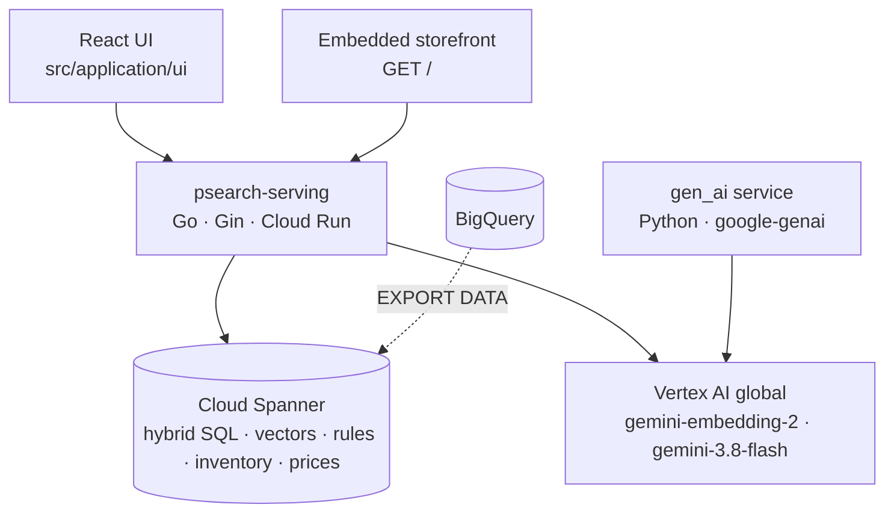

# PSearch — Biggy Search on Cloud Spanner + Gemini

PSearch is a multi-tenant e-commerce search service. It fuses lexical and semantic retrieval inside **Cloud Spanner**, uses **Gemini on Vertex AI (`global`)** for embeddings and query understanding, and layers merchandising, personalization, delivery promises and B2B pricing on top — all behind one `/api/search` endpoint.

All **14 Biggy Search / IS 2.0 requirements (4.1.1–4.1.14)** are delivered across Waves 1–5 and live on Cloud Run revision **`psearch-serving-00025-5mx`**. The service is built and operated by a [Scion software factory](docs/scion/README.md) of AI agents.

| Document | Contents |
|---|---|
| [PRODUCT.md](PRODUCT.md) | Product requirements for all 14 capabilities |
| [DESIGN.md](DESIGN.md) | Architecture, SQL design, scoring math, full API reference, configuration |
| [DEPLOYMENT.md](DEPLOYMENT.md) | Deployment guide, migrations 011–021, runtime config, release log |
| [REVIEW.md](REVIEW.md) | Code review log through Wave 5 and Issue #23 |
| [knowledge-plane/INDEX.md](knowledge-plane/INDEX.md) | ADR-001 … ADR-008, engineering invariants, playbooks |
| [docs/scion/verification-and-eval.md](docs/scion/verification-and-eval.md) | 5-layer product evaluation pyramid and verification methodology |

---

## Capabilities

| # | Capability | Highlights | Issue |
|---|---|---|---|
| 4.1.1 | Hybrid search | RRF over vector + full-text legs weighted by `alpha` | #1 |
| 4.1.2 | Vector search | `gemini-embedding-2` 1024-d (`embedding_v2`), Blue/Green v1/v2, two-tier embedding cache | #2, #11 |
| 4.1.3 | Availability | visibility, channel and in-stock filters; out-of-stock always last | #3 |
| 4.1.4 | Multi-language & tenant catalog | `tenant_id`, `locale`, accent-insensitive search | #4 |
| 4.1.5 | Server-side facets | 4 concurrent Spanner aggregations over the top-100 candidates | #5 |
| 4.1.6 | Merchandising rules | pins, buries, boosts + 8 business signals in the SQL score; `/api/rules` | #6 |
| 4.1.7 | Low-relevance synonyms | tenant/locale synonyms at 0.3× weight, exact matches first; `/api/synonyms` | #7 |
| 4.1.8 | Delivery promises | interleaved `skus` → `regional_inventory`, CEP/SLA filter, "Chega amanhã" labels | #8 |
| 4.1.9 | Autocomplete | accent-folded n-gram index; `/api/autocomplete` | #9 |
| 4.1.10 | Learning to Rank | Spanner top-100 + in-memory 12-feature re-ranker (`ltr=true`) | #10 |
| 4.1.11 | Conversational query understanding | parser-first price/brand/category extraction, optional Gemini fallback | #19 |
| 4.1.12 | Session personalization | session centroid re-ranking; `/api/session/events` | #20 |
| 4.1.13 | Zero-results recovery | n-gram spell check ("sansung" → "samsung"), AND → OR relaxation | #21 |
| 4.1.14 | B2B contract pricing | interleaved `product_prices`, effective price, `sort_by` | #22 |

**Models (Issue #23):** `gemini-3.8-flash` (text/flash), `gemini-4-argon` (pro), `gemini-embedding-2` (embeddings, 1024-d), Vertex AI location `global`, via the Google Gen AI SDK.

---

## Architecture



One Spanner statement runs both retrieval legs, fuses them with RRF and applies filters, boosts, rules, availability and pricing; the Go service adds query understanding, recovery, facets, delivery promises, LTR and personalization. Details: [DESIGN.md](DESIGN.md).

---

## API at a glance

```bash
BASE=http://localhost:8080   # or your Cloud Run service URL

# Hybrid search with conversational parsing (default on), delivery promise and contract price
curl "$BASE/api/search?q=tenis+de+corrida+ate+200+reais&cep=01310-100"
curl "$BASE/api/search?q=laptop&price_table_id=b2b-corporate&sort_by=price_asc"
curl "$BASE/api/search?q=shoes&alpha=0.7&ltr=true&session_id=sess-demo-0001"

# Typeahead, synonyms, rules, sessions, info
curl "$BASE/api/autocomplete?q=gel&locale=pt-BR"
curl "$BASE/api/synonyms?locale=pt-BR"
curl "$BASE/api/rules"
curl -X POST "$BASE/api/session/events" -H 'Content-Type: application/json' \
     -d '{"session_id":"sess-demo-0001","product_id":"prod-003","event_type":"purchase"}'
curl "$BASE/api/info"
```

| Endpoint | Auth |
|---|---|
| `GET/POST /api/search` (also `/search`) | public |
| `GET /api/autocomplete` | public |
| `GET /api/rules` · `POST /api/rules` · `PUT/DELETE /api/rules/:id` | public · admin |
| `GET /api/synonyms` · `POST /api/synonyms` | public · admin |
| `POST/GET /api/session/events` | public |
| `GET /api/config/embedding-version` · `POST` | public · admin |
| `GET /api/info`, `GET /health` (`/healthz`, `/api/health`) | public |

Admin writes need `X-Admin-Token` matching `ADMIN_TOKEN` (disabled when unset). Every `/api/search` parameter (`q`, `alpha`, `limit`, `category`, `brand`, `only_in_stock`, `channel`, `tenant_id`, `locale`, `cep`, `max_sla_hours`, `ltr`, `parse_intent`, `min_price`, `max_price`, `price_table_id`, `sort_by`, `session_id`, `session_product_ids`) and response field is documented in [DESIGN.md §15](DESIGN.md#15-api-reference). The OpenAPI contract lives in [knowledge-plane/contracts/biggy-search-openapi.yaml](knowledge-plane/contracts/biggy-search-openapi.yaml).

---

## Quick start (local)

```bash
# Search API — in-memory engine, no GCP needed
cd src/psearch/serving
USE_MEMORY_STORE=true go run ./cmd/server          # http://localhost:8080 (storefront at /)
go vet ./... && go test -race ./...

# React UI
cd src/application/ui
npm install --legacy-peer-deps
REACT_APP_API_URL=http://localhost:8080 npm start   # http://localhost:3000
```

Against Spanner and Vertex AI, set `PROJECT_ID`, `SPANNER_INSTANCE_ID`, `SPANNER_DATABASE_ID`, `ACTIVE_EMBEDDING_VERSION=v2`, `GENAI_LOCATION=global`, `TEXT_FOLDING=true` and Application Default Credentials. The full variable list is in [DESIGN.md §16](DESIGN.md#16-configuration-environment); deployment steps are in [DEPLOYMENT.md](DEPLOYMENT.md).

---

## Repository structure

```
src/psearch/serving/        Go search API (cmd/server, cmd/sqlcheck, cmd/backfill-embeddings, internal/{api,config,models,services})
src/psearch/gen_ai/         Python Gen AI service (enrichment, marketing, images, SQL agent)
src/psearch/ingestion_source/  Source ingestion service
src/application/ui/         React UI (search, facets, rules manager, session panel)
src/iac/                    Terraform modules, Spanner migrations (src/iac/migrations), BigQuery scripts
knowledge-plane/            ADRs, OpenAPI contract, playbooks
docs/scion/                 Software-factory playbook, runbooks, verification & evaluation
tooling/                    Enrichment and load-test tooling
```

---

## Built by a software factory

PSearch is delivered by Scion agents — `lead` (orchestration), `backend`, `frontend`, `reviewer`, `deployer` — following the [GitHub issue workflow](knowledge-plane/playbooks/GITHUB-ISSUE-FACTORY-WORKFLOW.md): ADR-backed design, review in private worktrees, a pre-deploy Spanner SQL gate (`cmd/sqlcheck`), deploys from clean `git archive` snapshots, and live verification posted on each issue. See [docs/scion/README.md](docs/scion/README.md) and [docs/scion/verification-and-eval.md](docs/scion/verification-and-eval.md).

## License

See [LICENSE](LICENSE). This is a demonstration project and not an officially supported Google product.
