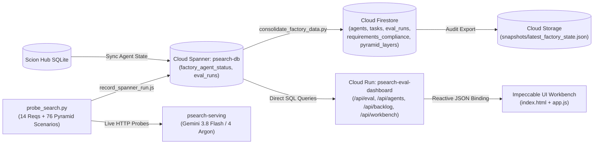

# `psearch-eval` — Control Tower, 5-Layer Product Evaluation Pyramid & Multi-Agent Factory Monitor

This orphan branch (`eval-dashboard`) houses the **`psearch-eval`** observability control tower, automated evaluation harness, and Impeccable UI workbench that continuously evaluates the **`psearch`** Software Factory (`main` branch), its **14 Biggy Search functional requirements (Waves 1–5)**, and the **5-Layer Product Evaluation Methodology Pyramid (`L1–L5`, 76 scenarios, 100% threshold)**.

> **Orphan Branch Isolation Invariant:** `eval-dashboard` operates as a strictly isolated orphan branch (`git merge-base origin/main origin/eval-dashboard` exits `1`). Changes are committed and pushed directly to `origin/eval-dashboard` and never merged or PR'd into `main`.

---

## 1. Live Service & Telemetry Endpoints

| Service / Component | Active Revision / Tier | Description | Live Endpoint / Resource Path |
|---|---|---|---|
| **`psearch-eval-dashboard`** | `psearch-eval-dashboard-00010-z5g` / `00011-tsf` | Impeccable UI Control Tower & Express Telemetry Server | [https://psearch-eval-dashboard-mhjw244bgq-uc.a.run.app](https://psearch-eval-dashboard-mhjw244bgq-uc.a.run.app) |
| **`psearch-serving`** | `psearch-serving-00025-5mx` | Target Hybrid Search Engine (`gemini-3.8-flash` + `gemini-4-argon`) | [https://psearch-serving-mhjw244bgq-uc.a.run.app](https://psearch-serving-mhjw244bgq-uc.a.run.app) |
| **Cloud Spanner** | `psearch-instance` / `psearch-db` | Authoritative `eval_runs`, `factory_agent_status`, and interleaved catalog | `projects/<GCP_PROJECT_ID>/instances/psearch-instance/databases/psearch-db` |
| **Cloud Firestore** | `(default)` Native Mode | Collections: `agents`, `tasks`, `eval_runs`, `requirements_compliance`, `pyramid_layers` | `projects/<GCP_PROJECT_ID>/databases/(default)/documents` |
| **Cloud Storage (GCS)** | Audit Snapshot Bucket | Immutable factory & evaluation state snapshots | `gs://psearch-eval-data-<GCP_PROJECT_ID>/snapshots/` |
| **Source Branch** | `eval-dashboard` | Isolated evaluation control tower repository branch | [duboc/scion-experiment@eval-dashboard](https://github.com/duboc/scion-experiment/tree/eval-dashboard) |
| **Design System** | Impeccable Style (`Operate` mode) | *Precision Telemetry Ledger* (Daylight & Carbon OKLCH themes) | [https://impeccable.style](https://impeccable.style) |

---

## 2. 5-Layer Product Evaluation Methodology Pyramid (`L1–L5`, 76 Scenarios)

`psearch-eval` enforces a **100% pass threshold** across all **76 live scenarios** spanning 5 architectural layers:

| Layer | Suite Identifier | Layer Name | Scenarios | Threshold | Verified Status | Evaluation Focus |
|---|---|---|---|---|---|---|
| **L1** | `l1_trajectory_sequence` | **Trajectory & State Sequence** | `12` | `100%` | **12 / 12 PASS** | State transition integrity, NL intent extraction (`stage_01`–`stage_02`), spell correction (`stage_03`–`stage_04`), synonym expansion (`stage_05`–`stage_06`), RRF fusion (`stage_07`–`stage_08`), Stage-2 LTR (`stage_09`–`stage_10`), session affinity (`stage_11`), and metadata envelope (`stage_12`). |
| **L2** | `l2_policy_guardrails` | **Policy & Business Guardrails** | `15` | `100%` | **15 / 15 PASS** | Multi-tenant isolation (`acme` vs `default`), strict locale partitioning (`pt-BR`, `en-US`, `es-MX`), stock gating & OOS tail demotion, B2B contract pricing (`b2b-corporate`, isolation, fallback), CEP validation (`01310-100`) & delivery radius SLA, merchandising boost cap ($\le 2.0\times$), negative price rejection, and read-only admin protection. |
| **L3** | `l3_adversarial_redteam` | **Adversarial & Red-Team Robustness** | `16` | `100%` | **16 / 16 PASS** | SQL/Spanner injection resilience (`UNION SELECT`, tautology), prompt injection & system XML/role spoofing resistance, XSS payload containment, Cyrillic homoglyph safety, oversized query & extreme parameter clamping (`alpha`, `limit`), null-byte safety, concurrent burst invariance, malformed JSON rejection, and deterministic idempotency. |
| **L4** | `l4_routing_and_parity` | **Multi-Mode Routing & Engine Parity** | `28` | `100%` | **28 / 28 PASS** | **10 Mode Routing Classifications** (Pure FTS $\alpha=0.0$, Pure Vector $\alpha=1.0$, Balanced $\alpha=0.5$, Hybrid $\alpha=0.65$ with formula $(1-\alpha)\cdot\text{text} + \alpha\cdot\text{vector}$, LTR active/passthrough, NL intent, spell check, B2B pricing, session personalization) + **18 Engine Parity Checks** comparing direct `psearch-serving` vs `/api/workbench` across 14 canonical fields and 4 facet/metadata dimensions. |
| **L5** | `l5_live_vertex_and_telemetry` | **Live Vertex AI & Factory Telemetry** | `5` | `100%` | **5 / 5 PASS** | Live `/health` verification, Vertex AI `global` model config (`gemini-3.8-flash` query classification, `gemini-4-argon` deep reasoning, `gemini-embedding-2` 1024-dim `v2`), Spanner `eval_runs` persistence, Firestore compliance sync, and GCS snapshot export. |
| **Total** | **`pyramid_summary`** | **All 5 Evaluation Layers (`L1–L5`)** | **`76`** | **`100%`** | **`76 / 76 PASS` (`100%`)** | End-to-end zero-mock production verification (`run_id: probe-1791941093-29012b`). |

---

## 3. 14 Biggy Search Functional Requirements Matrix (Waves 1–5)

All **14 functional requirements** (`4.1.1`–`4.1.14`), plus infrastructure upgrades **#11** (1024-dim `gemini-embedding-2` `v2`) and **#23** (`gemini-3.8-flash` & `gemini-4-argon` on Vertex AI `global`), are continuously probed against live `psearch-serving`:

| Code | Issue(s) | Wave | Requirement Title | Owner Agents | Verified Status | Live Evidence Highlights |
|---|---|---|---|---|---|---|
| **4.1.1** | `#1` | `wave-1` | Dynamic Hybrid Search ($\alpha$-RRF Fusion) | `@backend · @frontend` | **PASS** | `effective_alpha=0.65`, Spanner SQL formula $(1-\alpha)\cdot\text{text} + \alpha\cdot\text{vector}$ |
| **4.1.2** | `#2`, `#11` | `wave-1` | Dense Vector Search (1024-dim `gemini-embedding-2` `v2`, Cache) | `@backend` | **PASS** | `embedding_dimension=1024`, `active_embedding_version=v2`, 2-tier memory + Spanner cache (`cache_hit=true`) |
| **4.1.3** | `#3` | `wave-1` | Inventory Availability & Out-of-Stock Tail Demotion | `@backend · @frontend` | **PASS** | `IN_STOCK` strictly ranked ahead of `OUT_OF_STOCK` items |
| **4.1.4** | `#4` | `wave-2` | Multilingual & Multi-Tenant Catalog (`pt-BR`, `en-US`, `es-MX`) | `@backend` | **PASS** | 100% locale isolation; `0` cross-locale or cross-tenant bleed |
| **4.1.5** | `#5` | `wave-2` | Server-Side Concurrent Facets (Go Goroutines) | `@backend · @frontend` | **PASS** | 4 facet dimensions (`categories`, `brands`, `price_ranges`, `availability`) in ~5.9ms |
| **4.1.6** | `#6` | `wave-2` | Merchandising Rules & 8 SQL Boost Signals | `@backend · @frontend` | **PASS** | `GET /api/rules` active; 8 boost signals & `rule_multiplier` verified |
| **4.1.7** | `#7` | `wave-3` | Low-Relevance Synonyms ($0.3\times$ Score Weight) | `@backend` | **PASS** | `GET /api/synonyms` (8 groups); `sneakers` $\to$ `UltraBoost Pro Running Shoes` at $0.3\times$ weight |
| **4.1.8** | `#8` | `wave-3` | Delivery Promises (CEP/SLA via `INTERLEAVE IN PARENT`) | `@backend` | **PASS** | `cep=01310-100` resolves Region `SP`, CD `cd-sp-cajamar`, SLA `24h` |
| **4.1.9** | `#9` | `wave-4` | Intelligent Autocomplete (BQ Analytics + `TOKENIZE_NGRAMS`) | `@backend · @frontend` | **PASS** | `GET /api/autocomplete?q=run` returns ranked suggestions with `search_count` & `ctr_score` |
| **4.1.10** | `#10` | `wave-4` | Two-Stage Learning to Rank (In-Memory Re-Ranking) | `@backend · @reviewer` | **PASS** | Model `baseline-2026-10`, Stage-2 latency $< 50\mu\text{s}$ ($\le 2000\mu\text{s}$ SLA) |
| **4.1.11** | `#19`, `#23` | `wave-5` | Conversational Query Understanding (`gemini-3.8-flash` & `gemini-4-argon`) | `@backend · @frontend` | **PASS** | Extracts `clean_query="running shoes"`, `brand="Adidas"`, `max_price=200`; `global` Vertex models active |
| **4.1.12** | `#20` | `wave-5` | Real-Time Session Personalization & Centroid Re-Ranking | `@backend · @frontend` | **PASS** | `POST /api/session/events` + `session_id` applies bounded `session_boost` ($\le 0.01$) |
| **4.1.13** | `#21` | `wave-5` | Zero-Results Recovery & Spell Check (`did_you_mean` + Relaxation) | `@backend · @frontend` | **PASS** | `q=sansung` $\to$ `did_you_mean="samsung"`, `auto_corrected=true`; multi-term relaxation verified |
| **4.1.14** | `#22` | `wave-5` | B2B / Contract Pricing & Custom Assortment (`product_prices`) | `@backend` | **PASS** | `price_table_id=b2b-corporate` applies $0.90\times$ contract tier (`$119` $\to$ `$107.10`) via interleaved table |

---

## 4. Telemetry & Evaluation Architecture



### Specialist Multi-Agent Fleet (Gemini 4 Argon · `agy v1.3.4`)
The `psearch-eval` control tower is operated by a 5-agent specialist team running on the Antigravity harness (`agy v1.3.4`) powered by **Gemini 4 Argon** (`gemini-4-argon` on Vertex AI `global`):
- **`@eval-lead`**: Evaluation & Observability Director orchestrating end-to-end sweeps, backlog verification, and release sign-off.
- **`@search-evaluator`**: Quantitative Relevance Engineer maintaining `probe_search.py`, `consolidate_factory_data.py`, and the 76-scenario Pyramid suite.
- **`@factory-analyst`**: Agentic Operations Specialist analyzing `factory_agent_status`, git commit cadence, and harness telemetry diagnostics.
- **`@ui-craftsman`**: Impeccable Design & Visualization Engineer crafting the *Precision Telemetry Ledger* UI (`index.html`, `app.js`, `DESIGN.md`).
- **`@eval-deployer`**: Cloud Run Release & Infrastructure Engineer executing Cloud Build submissions and live traffic cutovers.

---

## 5. Repository Structure (`eval-dashboard` Branch)

```text
/workspace/
├── cmd/eval-server/                        # Go evaluation server & embedded UI
│   ├── main.go
│   └── ui.html
├── internal/eval/                          # Go evaluation runner & factory diagnostics tests
│   ├── runner.go
│   └── runner_test.go
├── eval-dashboard/                         # Cloud Run Node.js/Express service & Python probe suite
│   ├── server.js                           # Express routes: /api/eval, /api/agents, /api/backlog, /api/workbench, /api/info
│   ├── public/
│   │   ├── index.html                      # Impeccable UI Workbench (5-Layer Pyramid, 14 Reqs, Alpha SVG, Topology)
│   │   └── app.js                          # Reactive client bindings, Pyramid scenario drilldown, Daylight/Carbon theme engine
│   ├── scripts/
│   │   ├── probe_search.py                 # Live probe worker: 6 golden queries, alpha sweep, 14 reqs, 76 Pyramid scenarios
│   │   ├── record_spanner_run.js           # Parameterized Spanner DML writer for eval_runs
│   │   ├── consolidate_factory_data.py     # Syncs Spanner + GitHub into Firestore & GCS snapshots
│   │   ├── ingest_telemetry.py             # Agent telemetry sync utility
│   │   └── deploy.sh                       # Cloud Build + Cloud Run deployment script
│   ├── Dockerfile
│   └── README.md                           # Package-level operational guide for probe & consolidation workers
├── README.md                               # Root control tower documentation (this file)
├── PRODUCT.md                              # Expanded PRD: 14 Requirements (4.1.1–4.1.14) & 5-Layer Pyramid (L1–L5)
├── DESIGN.md                               # Impeccable Design System specification & Express API architecture
└── DEPLOYMENT.md                           # Cloud Run deployment history & live verification ledger
```

---

## 6. Quickstart & Live Verification Commands

```bash
# 1. Verify orphan branch isolation (must exit 1 with no common ancestor)
git fetch origin main eval-dashboard
git merge-base origin/main origin/eval-dashboard || echo "Verified: orphan branch isolated"

# 2. Run Go unit tests for factory telemetry diagnostics
go test -v ./internal/eval/...

# 3. Execute live 14-requirement + 76-scenario 5-Layer Evaluation Pyramid sweep
export GCP_PROJECT="<GCP_PROJECT_ID>"
python3 eval-dashboard/scripts/probe_search.py

# 4. Consolidate Spanner, Firestore, and GCS snapshots
python3 eval-dashboard/scripts/consolidate_factory_data.py

# 5. Verify live Cloud Run /api/eval telemetry payload
curl -s https://psearch-eval-dashboard-mhjw244bgq-uc.a.run.app/api/eval | \
  jq '{run_id, pass_count, overall_ndcg_at_10, overall_mrr_at_10, p50_latency_ms, p95_latency_ms, pyramid_summary}'
```
