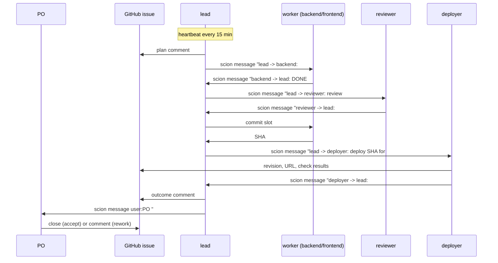

# Agent protocol

The rules every agent follows, and why. The literal text the agents get is
[`templates/_shared/agents.md`](templates/_shared/agents.md) plus each role's `system-prompt.md`; this page explains
the design so you can adapt it without losing what makes it work.

## Principles

1. **GitHub is the memory.** Agents lose context (restarts, compaction, replacement). Anything another agent or the PO
   needs must be on the issue: plan, evidence, decisions, what's next.
2. **Only delivered messages count.** An agent's own output is invisible to everyone else. A handoff exists when
   `scion message` printed `Message delivered` (or `Message sent to user:<email>.` when messaging the PO), not before (L4).
3. **Every turn ends with a status.** `blocked`, `task_completed` or `ask_user` tells the Hub, and anyone looking,
   whether an agent is waiting on purpose or dead (L5).
4. **Something always wakes the leads.** Agents only react to input, so a heartbeat schedule prompts each lead every
   15 minutes; the lead's wake-up steps are idempotent, so extra or missed heartbeats do no harm (L5, L11).
5. **Evidence over claims.** No invented numbers, real file paths only, and a check for every "it exists" (L9).
6. **Narrow escalation.** The PO decides IAM, cost and scope; the lead decides everything else and keeps moving (L17).
7. **Leads orchestrate.** A lead that writes code stops coordinating (L15).

## Who talks to whom

## Message conventions

| Kind | Format | Example |
|---|---|---|
| Any message | `<from> -> <to>: <text>` | `lead -> frontend: #3: add the availability filter to SearchPage.tsx; build must pass` |
| Report | `DONE #N: <changed files>, <test command and result>, <risks>` | `backend -> lead: DONE #1: serving/internal/search/hybrid.go, go test ./... ok` |
| Verdict | `#N <PASS or FAIL>: <evidence>` | `reviewer -> lead: #1 FAIL: hybrid.go:88 ignores alpha when q is empty (go test -run TestAlpha fails)` |
| Escalation | `<decision needed, options, recommendation>` to `user:<PO email>` | `lead -> PO: #11 needs roles/aiplatform.user for the runtime SA. Options: grant it, or keep v1. I recommend granting.` |

Long or multi-line messages go through `scion message <agent> --body-file <file>` (shell quoting breaks inline text).

## Status signals

| When | Command |
|---|---|
| Waiting on someone or something (leads, reviewer and deployers after every turn) | `sciontool status blocked "waiting: <what, from whom>"` |
| Assignment done and reported (workers) | `sciontool status task_completed "
"` |
| Only a human can unblock | `sciontool status ask_user "<question>"` (and message the lead) |

## Evidence on issues

A useful issue comment answers: what changed (SHA or files), how it was verified (command and result), and what
happens next. For a deploy: revision, URL, and each acceptance check with its HTTP status and the relevant part of the
response. For a review: files reviewed, commands run, verdict, and for a FAIL the file and line or the failing command.

## Liveness rules for leads

- Anyone the lead waits on, silent for more than 30 minutes: `scion message` (check delivery).
- Still silent 30 minutes later: `scion message --interrupt <agent> "..."`. Note: `--wake` only resumes suspended agents; if an agent is stopped, run `scion resume <agent>` (or ask the PO to start it).
- Don't ping agents you aren't waiting on (L19).
- PO decisions pending: remind every 2 hours; meanwhile work on other issues.

## Git in a shared workspace

All agents of a project share one checkout, so one agent at a time commits (the "commit slot", granted by the lead),
staging only its own files (`git add <files> && git commit -m "... (#N)" && git push origin <branch>`); if push is rejected,
stash uncommitted edits before rebasing (`git stash push -u -m "pre-rebase" && git pull --rebase origin <branch> && git push origin <branch> && git stash pop`),
and destructive git commands are forbidden because they would destroy other agents' uncommitted work. The [v2 design](specs/factory-orchestration-v2-design.md) replaces this with one clone, branch and PR per issue.

## Adapting the protocol

- Keep the protocol short and in one shared file; every rule you add competes for the agents' attention.
- When a stall happens, find which principle failed and fix the rule or the heartbeat, not just the instance. Record
  it in [lessons-learned.md](lessons-learned.md).
- Change running agents by message, and the templates for the next start.
