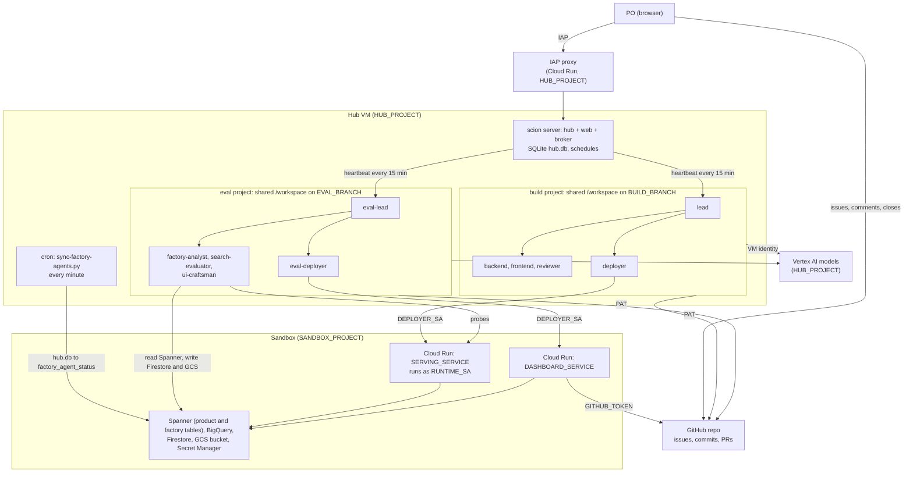

# Architecture

Two Scion projects run on one self-hosted Scion Hub. The **build factory** turns GitHub issues into a deployed service;
the **eval factory** measures the build factory and the service, and shows the results on a dashboard. A human product
owner (PO) steers both through GitHub and the Scion web UI.

## Components

| Component | Where | Role |
|---|---|---|
| Scion Hub | VM in `HUB_PROJECT`, user `HUB_OS_USER` | `scion server start --foreground --hosted --enable-hub --enable-web --web-port 8080 --enable-runtime-broker`: state (SQLite `~/.scion/hub.db`), web UI, and a co-located Docker runtime broker that runs every agent container. Nightly release channel with `notify` update policy (controlled updates). |
| IAP proxy | Cloud Run in `HUB_PROJECT` | The web UI and API are reached through Identity-Aware Proxy (`server.auth.mode: proxy`). Agents talk to the Hub over the VM's internal address (`server.hub.agent_endpoint`). |
| Agent containers | Docker on the VM, named `<project>--<agent>` | One container per agent, with its harness (Claude Code, Antigravity, OpenCode, Hermes) in a tmux session `scion`. `/workspace` is the project folder `~/.scion/projects/<project>`. |
| Harness configs | `~/.scion/harness-configs/<harness>/` on the VM | Image, provisioner, launch command and auth per harness. Note that in hosted mode, the Hub provisions agents from bundled configs in `~/.scion/workspace-storage/hubs/<hub-id>/harness-configs/global/` rather than `~/.scion/harness-configs/<harness>/` directly. Project pre-start hooks are used for durable post-provisioning customization. All harnesses use Vertex AI with the VM's identity, billed to `HUB_PROJECT` ([`config/hub-settings.example.yaml`](config/hub-settings.example.yaml)). |
| Templates | Hub, per project | Role prompts and settings ([`templates/`](templates/)). |
| Schedules | Hub | Admin-owned cron jobs that message each lead every 15 minutes (the heartbeat). |
| Watchdog daemon | cron on the VM | [`factory-watchdog.py`](scripts/factory-watchdog.py) runs every 5 minutes: guards provisioners against drift, restores schedules, wakes suspended agents, restarts crashed workers (3/hr circuit breaker), and forwards PO escalations to Cloud Logging. |
| Agent-status sync | cron on the VM | [`sync-factory-agents.py`](scripts/sync-factory-agents.py) copies agent state from `hub.db` to Spanner every minute, so the dashboard can show it without Hub access. |
| Backups | cron & GCE snapshots | [`backup-hub.sh`](scripts/backup-hub.sh) creates daily online SQLite backups and state tarballs (14-day retention); GCE disk snapshot policy runs daily at 04:00 UTC. |
| Alerts & Budgets | Cloud Monitoring in `HUB_PROJECT` | Log-based alert policy on `scion-factory-alerts` (Cloud Monitoring email notifications to PO). Monthly billing budgets ($150 Hub, $150 Sandbox) with 50%, 80%, 100% actual and 120% forecasted spend threshold alerts. |
| GitHub repo | `GITHUB_REPO` | Issues are the backlog and the record of work; `BUILD_BRANCH` holds the product, `EVAL_BRANCH` the eval code. |
| Sandbox | `SANDBOX_PROJECT` | Everything the factories build and run: the product service, its Spanner and BigQuery data, the dashboard, Firestore, a data bucket, the `github-token` secret. Kept apart from the Hub project so agents can't break the Hub. |

## Identities

| Who | Identity | Grants | Why |
|---|---|---|---|
| Agents (default) | Hub VM SA (Scion `passthrough` mode) | `HUB_PROJECT`: `aiplatform.user` (models), log/metric/trace writers. Sandbox: `datastore.user`, `serviceusage.serviceUsageConsumer`, `spanner.databaseUser` on the database, `storage.objectAdmin` on the data bucket | Model calls; workers query Spanner/Firestore/GCS for tests and evaluation, while Cloud Run deployments and IAM mutations are restricted to deployers holding `DEPLOYER_SA`. |
| Deploy agents | `DEPLOYER_SA` (Scion `assign` mode) | Sandbox: `run.admin`, `cloudbuild.builds.editor`, `artifactregistry.admin`, `storage.admin`, `logging.viewer`, `serviceusage.serviceUsageConsumer`, `aiplatform.user`, `iam.serviceAccountUser`, `datastore.user`, `spanner.admin`, `spanner.databaseAdmin`, `bigquery.admin` | Deploys and migrations. Broad on purpose for a throwaway sandbox; scope `iam.serviceAccountUser` to the runtime and build SAs for anything shared. |
| Hub VM SA, for the deployers | | `iam.serviceAccountTokenCreator` and `iam.serviceAccountUser` on `DEPLOYER_SA` | Scion mints the deployer's tokens with the VM's identity. |
| Product service | `RUNTIME_SA` | `aiplatform.user` (project), `spanner.databaseUser` (database) | Exactly what the code uses (L7). |
| Dashboard | the default compute SA today | `secretAccessor` on `github-token`, Spanner read | Works, but the same SA also runs Cloud Build for source deploys and holds broad roles. Give the dashboard its own read-only SA, as for the product (L7). |
| Cloud Build (source deploys) | the default compute SA | `cloudbuild.builds.builder` | `gcloud run deploy --source` builds the image with this identity. |
| GitHub | the PO's personal access token (repo scope) | push, issues, PRs | Simple, but every action shows as the PO and PR approvals are impossible (L14). A GitHub App is the long-term fix. |

## How work flows

1. **Intake.** Issues labeled with the project slug (`BUILD_PROJECT`) and `wave-N` form the backlog; `Depends on #N`
   in an issue body orders it further.
2. **Plan.** The lead picks the next issue (lowest wave, then lowest number; at most 2 in flight) and comments a plan.
3. **Build.** The lead briefs the worker that owns the files; the worker implements and tests, then reports with
   `scion message`.
4. **Review.** The lead reads the diff and asks the reviewer for a verdict; PASS or FAIL comes back by message, with
   evidence.
5. **Commit.** One agent at a time holds the commit slot in the shared workspace; commits reference `(#N)` and push directly without running dirty rebases.
6. **Deploy.** The deployer exports the commit SHA via `git archive` to a clean temp directory, applies migrations, deploys, runs acceptance checks, rolls back on failure (passing `--to-latest` on the next deploy), and posts revision, URL and results on the issue.
7. **Accept.** The lead tells the PO the issue is ready; the PO closes it or comments what to change.

The PO escalation path is narrow on purpose: IAM grants, cost, scope. Everything else the lead decides.

## How the factory stays awake

- **Heartbeat:** every 15 minutes a schedule messages each lead ([`config/heartbeat-message.txt`](config/heartbeat-message.txt)).
  The lead re-checks its agents and the issues, nudges whoever is overdue, moves work forward, and sets its status.
- **Watchdog & Circuit Breaker:** [`scripts/factory-watchdog.py`](scripts/factory-watchdog.py) runs every 5 minutes on the VM to catch provisioner drift, restore schedules, wake suspended agents, and restart crashed workers with a 3/hr circuit breaker.
- **Push Alerts:** PO escalations and circuit-breaker triggers are forwarded to Cloud Logging (`scion-factory-alerts`) to send real-time email alerts to the PO.
- **Controlled Updates:** `server.maintenance.update_policy: notify` prevents unannounced Hub updates from resetting provisioner configurations.
- **Turn discipline:** every agent ends each turn with `sciontool status blocked | task_completed | ask_user`, so a
  quiet agent can be told apart from a dead one.
- **Delivery checks:** agents only count a handoff as done when `scion message` printed `Message delivered` (or `Message sent to user:` for the PO).
- **GitHub as memory:** state lives in issue comments and commits, so a restarted or replaced agent can continue.

## How the factory is observed

| Signal | Source | Consumer |
|---|---|---|
| Agent phase, activity, last activity | `hub.db` -> Spanner `factory_agent_status` (every minute) | dashboard, factory-analyst |
| Issues, commits, branches | GitHub API | dashboard, factory-analyst |
| Search quality and latency | probes -> Spanner `eval_runs` | dashboard |
| History snapshots | `consolidate_factory_data.py` (eval code) -> Firestore, `gs://DATA_BUCKET/snapshots/` | dashboard |
| Everything at once, for operators | [`scripts/factory-status.sh`](scripts/factory-status.sh) | you |

## Decisions and trade-offs

| Decision | Chosen | Trade-off |
|---|---|---|
| Hub hosting | One VM: hub, web and broker together, SQLite | Cheap and simple; a single point of failure, and upgrades restart everything. |
| Workspaces | Shared `/workspace` per project, commit slot | Works with Hub-managed projects; git-backed shared projects (or clone-per-agent in v2) avoid manual git init and serialize commits safely (L8). |
| Coordination | GitHub issues plus `scion message`; schedules for heartbeats | No extra infrastructure; relies on agents following the protocol, so the protocol is short and repeated in every template. |
| Harnesses | Mixed (Claude Code, Antigravity, OpenCode, Hermes) | Lets you compare them; each had its own failure mode (L3, L4, L6). |
| Credentials | PAT for GitHub, VM identity for models, assigned SA for deploys | Few secrets to manage; coarse identities (L14). |
| Sandbox | Separate project for everything agents create | Agents can't damage the Hub; costs one more project. |

The next step is the [v2 design](specs/factory-orchestration-v2-design.md) (draft): one worker and one PR per issue in
its own clone, status labels and a pinned board issue on GitHub, a deterministic `factoryctl` helper, and watchdogs for
the leads.
