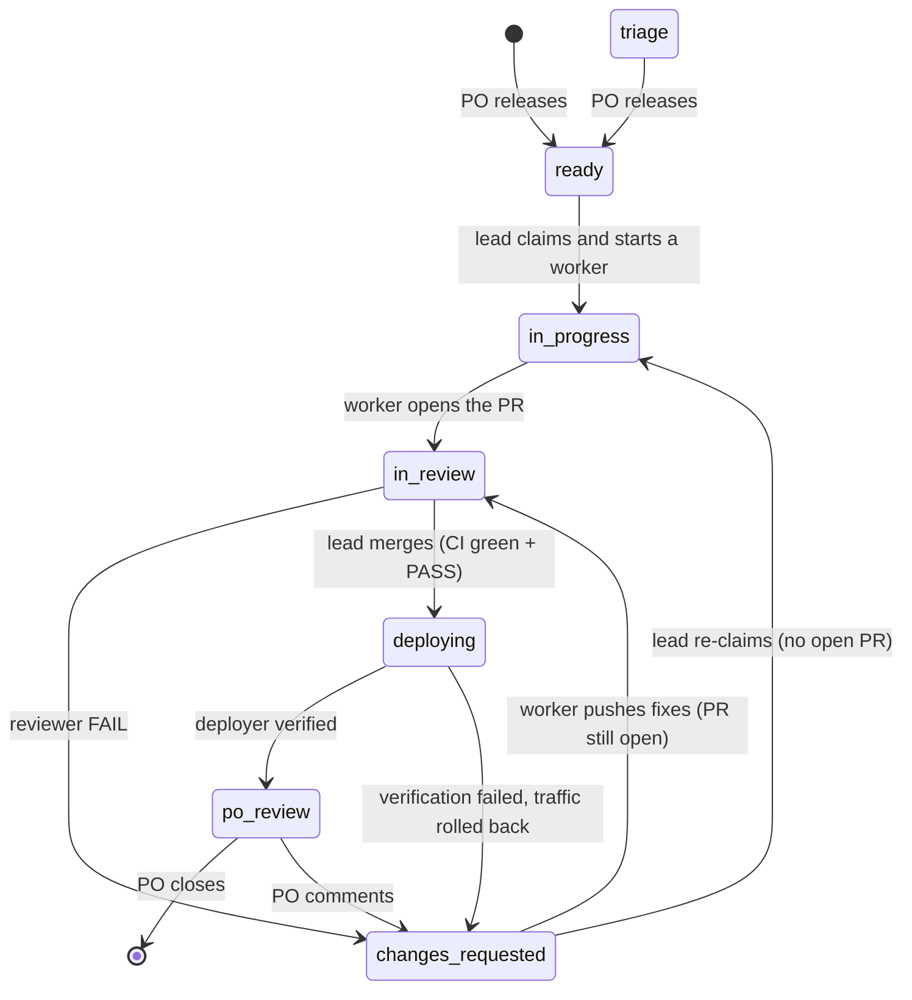

# Design Spec: Factory Orchestration v2 — GitHub-Issues-Driven, Self-Sustaining Factories

| | |
|---|---|
| **Date** | 2026-10-10 |
| **Status** | Draft — awaiting PO review |
| **Product owner** | the PO (a Hub admin) |
| **Repository** | `GITHUB_REPO`: `main` (psearch), `eval-dashboard` (psearch-eval) |
| **Scion Hub** | one VM in `HUB_PROJECT`: hub + web + Docker broker, behind the IAP proxy |
| **Sandbox** | `SANDBOX_PROJECT` (`SANDBOX_REGION`) |
| **Supersedes** | The commit-slot workflow in `knowledge-plane/playbooks/GITHUB-ISSUE-FACTORY-WORKFLOW.md` |

> [!NOTE]
> Draft design, awaiting PO review, **not implemented**. The running factory uses the shared-workspace protocol in
> [`../templates/`](../templates/) and [`../agent-protocol.md`](../agent-protocol.md). Values such as `GITHUB_REPO`
> and `SANDBOX_PROJECT` refer to [`../config/factory.env.example`](../config/factory.env.example); paths such as
> `pkg/agent/run.go` are in the Scion repository.

---

## 1. Problem

Observed on 2026-10-09/10:

1. **Leads only react.** A lead ends its turn "waiting for backend…", and nothing wakes it if that message never arrives. The Hub `schedules` table is empty. After the last commit (2026-10-10 00:07Z), the psearch factory produced no commits or comments for ~19 hours.
2. **Worker notifications go to the PO, not the leads.** All 10 agents' subscriptions (`COMPLETED`, `WAITING_FOR_INPUT`, `LIMITS_EXCEEDED`, `STALLED`, `ERROR`) target the admin user, because the agents were created as admin.
3. **Hub activity is noise.** 8 of 10 agents showed `stalled`. A Claude lead that ends its turn without `sciontool status blocked` is flagged `STALLED` after ~5 minutes, and the current prompts forbid `sciontool status`.
4. **State lives in agent chat memory.** 11 open issues, no status or owner labels, no PRs. #1 has zero comments despite being dispatched; the lead implemented #11 itself after two failed backend attempts.
5. **One shared `/workspace`.** Neither Hub project has a git remote, so every agent mounts the same folder, work is serialized through a commit slot, and parallel issues are impossible.
6. **A lost handoff deadlocked the factory for ~23 hours.** At 00:05Z the lead told the deployer to hold #11 "until my GO" and waited for the reviewer's verdict. At 00:07Z the reviewer (Hermes) wrote "lead <- reviewer: … FAIL" in its own output but never ran `scion message`, so the Hub recorded no message. Lead, deployer and reviewer all waited on each other, and nothing woke them. The `FAIL` itself was wrong: the reviewer looked for files that don't exist (`ADR-001.md`, `011-gemini-v2-embeddings.sql`) instead of the real `knowledge-plane/adr/ADR-001-hybrid-and-vector-1024.md` and `src/iac/migrations/011_add_embedding_v2_gemini_1024.sql`.

## 2. Goals, non-goals, success criteria

**Goals**
- **G1.** Both factories keep working without PO nudges until every released issue is in `po-review`, closed, or `blocked` with a diagnosis.
- **G2.** GitHub Issues and PRs are the single coordination bus and source of truth; agent chat memory is disposable.
- **G3.** The PO controls intake, acceptance and pausing entirely from GitHub labels and comments.
- **G4.** No silent stalls: every stuck agent gets a recovery action within 90 minutes.
- **G5.** One isolated workspace and branch per issue; up to 2 issues in flight per factory.
- **G6.** The protocol emits structured data that the `psearch-eval` dashboard consumes.

**Non-goals** (follow-ups in §12): fixing Scion worktree-per-agent, native GitHub webhook routing, a GitHub App bot identity, and any Scion code change.

**Success criteria**
- The pilot on issue #1 passes every check in §9.2.
- Full run: every issue ends in `po-review`, closed, or `blocked` with a diagnosis; no issue spends more than 60 minutes without progress or a recovery action; no lead silence longer than 45 minutes goes unrecovered.

## 3. Decisions

| # | Decision | Choice |
|---|---|---|
| D1 | Autonomy | Agents implement, test, merge, deploy to `SANDBOX_PROJECT` and verify, then set `status:po-review` and move on. The PO closes or requests changes. |
| D2 | Code flow | One branch + PR per issue. The reviewer posts its verdict on the PR, the lead squash-merges on CI green + reviewer `PASS`, the deployer ships from `main`. |
| D3 | psearch-eval | Same protocol with its own issues (`project:psearch-eval`, base branch `eval-dashboard`); the eval team uses the protocol's data for the dashboard. |
| D4 | WIP | At most 2 issues in flight per factory; one fresh worker per issue. |
| D5 | Approach | Protocol plus a deterministic `factoryctl` CLI on Scion built-ins (schedules, notifications, `sciontool status`). |
| D6 | Workspaces | Scion clone-per-agent (`per-agent` mode) now; switch to worktree-per-agent after the Scion fixes in §12. |

## 4. GitHub protocol

### 4.1 Labels

| Label | Set by | Meaning |
|---|---|---|
| `status:triage` | agents | An issue an agent filed, waiting for the PO's decision |
| `status:ready` | PO | Released; the lead may start it |
| `status:in-progress` | lead | Claimed; a worker owns it |
| `status:in-review` | worker | PR open, waiting for the reviewer's verdict |
| `status:changes-requested` | reviewer, deployer, PO | Rework needed |
| `status:deploying` | lead | PR merged; the deployer is shipping and verifying |
| `status:po-review` | deployer | Live in the sandbox with evidence; waiting for the PO |
| `status:blocked` | any agent | Needs a decision or an external fix; escalated to the PO |
| `status:hold` | PO | Parked; agents don't touch it |
| `project:psearch`, `project:psearch-eval` | PO, agents | Which factory owns the issue (the existing `psearch` label is renamed to `project:psearch`) |
| `factory:board` | setup | Marks the pinned Factory board issue |
| `factory:paused` | PO | On the board issue: no new issue starts; in-flight work continues |

The existing `wave-1`…`wave-4`, component and type labels stay. **Invariant:** an open issue with a `project:*` label has at most one `status:*` label; no status label means backlog (not released).

### 4.2 State machine



Also allowed: any open status → `blocked` (by an agent, with a `blocked` comment that records the previous status); `blocked` → the recorded previous status (by the lead, once resolved); any status → `hold` and `hold` → `ready` (PO only). `factoryctl` rejects every other transition.

### 4.3 Ordering

`factoryctl next` returns the `status:ready` issue that has no `status:hold`, whose `Depends on #N` issues are all in `po-review` or closed, with the lowest `wave-*` label, then the lowest issue number. It returns nothing when WIP is full or the board issue has `factory:paused`.

### 4.4 Comment protocol

Every agent comment, on issues and PRs, opens with a signature line and ends with a hidden footer:

```
🤖 **psearch-be-7** (backend · opencode) → status:in-review
PR #14 adds @alpha to the RRF query; go test ./... passes. Next: reviewer.
<!-- factory:v1 {"agent":"psearch-be-7","role":"backend","issue":7,"event":"handoff","status":"in-review","prev":"in-progress","pr":14,"ts":"2026-10-10T20:15:00Z"} -->
```

- **Footer fields:** `agent`, `role`, `issue`, `event`, `status`, `prev`, `ts`; optional `pr`, `verdict` (reviews), `revision` (deploys), `action` (recoveries).
- **Events:** `claim`, `plan`, `progress`, `handoff`, `review`, `deploy`, `blocked`, `unblocked`, `recovery`, `escalation`, `ack` (reply to the PO), `board`.
- **Cadence:** a comment on every status change, whenever blocked, and at least every 60 minutes while a worker is working. Workers push their branch with every progress comment.
- **PO input:** any comment without a `factory:v1` footer is the PO's. It is *unanswered* until an agent comment with `event: ack`, or a later status change, follows it. The lead answers it on its next cycle.

### 4.5 Pull requests

- **Branch:** `issue-<N>-<slug>` (lowercase, hyphens only; Scion turns `/` into `-`). Rework after PO feedback uses `issue-<N>-<slug>-b`, `-c`, and so on.
- **Title and body:** `[#N] <summary>`; the body has `Refs #N`, a summary and test evidence. Never `Closes #N`, because the PO closes issues.
- **CI on every PR** (the workflow file lives on each base branch):
  - `main`: `go test ./...` in `src/psearch/serving`, `npm ci && npm run build` in `src/application/ui`, and `python3 -m unittest discover tools/factory/tests`.
  - `eval-dashboard`: the dashboard build plus `impeccable detect --json` (fails on findings).
- **Reviewer verdict** is a signed PR comment (`event: review`, `verdict: PASS` or `FAIL`). All agents use the PAT, so the PO authors every PR, and GitHub doesn't let an author approve or request changes on their own PR. `gh pr review --approve` is never used, and no branch protection requires approvals.
- **What the reviewer checks:** the PR's actual changed files (`gh pr view <PR> --json files`) and the ADRs listed in `knowledge-plane/INDEX.md`, never guessed paths. A `FAIL` must cite a concrete file and line, or a failing command and its output.
- **Merge:** the lead merges one PR at a time with `gh pr merge <PR> --squash --delete-branch`, only when CI is green and the latest verdict on the PR's head commit is `PASS`.
- **Conflicts:** when a merge makes another open PR conflict, the lead asks that PR's worker to run `git fetch origin && git rebase origin/main && git push --force-with-lease`. CI re-runs; the reviewer decides whether the rebase needs a new review.

### 4.6 Factory board issue

One pinned issue per project, labeled `factory:board` and `project:*`, titled `🏭 Factory board — <project>`. `factoryctl board --publish` rewrites its body on every lead cycle: WIP, each issue's status, owner, age, PR, CI and verdict, open actions, recent recoveries, and a footer `<!-- factory:v1 {"event":"board","ts":"…"} -->` that the lead-liveness check reads.

### 4.7 PO controls

- **Intake:** add `status:ready` to release an issue; `status:hold` parks it; decide on `status:triage` issues.
- **Acceptance:** close a `po-review` issue to accept it; to reject, comment and set `status:changes-requested`.
- **Unblocking:** answer the `blocked` comment; the lead resumes on its next cycle.
- **Pause:** add or remove `factory:paused` on the board issue.
- **Escalations** reach the PO as Scion inbox messages, in addition to the GitHub label.

## 5. Agents and lifecycle

### 5.1 Topology

| Project | Long-lived agents | Per-issue workers (template) |
|---|---|---|
| `psearch` (base `main`) | `lead` (Claude); `reviewer` (Hermes); `deployer` (Claude, the only agent with `DEPLOYER_SA` credentials, and the backup watchdog) | `psearch-be-<N>` (`backend`, OpenCode); `psearch-fe-<N>` (`frontend`, Antigravity) |
| `psearch-eval` (base `eval-dashboard`) | `eval-lead` (Antigravity, also reviews eval PRs); `eval-deployer` (Antigravity, backup watchdog) | `eval-ui-<N>` (`ui-craftsman`); `eval-fa-<N>` (`factory-analyst`); `eval-se-<N>` (`search-evaluator`) |

Leads never write product code; they orchestrate with `factoryctl`, `gh` and `scion`.

### 5.2 Worker lifecycle

1. **Start.** The lead runs `scion start psearch-be-7 -t backend --branch issue-7-alpha "Your brief is GitHub issue #7 in GITHUB_REPO. Follow knowledge-plane/playbooks/FACTORY-PROTOCOL.md."` The Hub auto-subscribes the lead to that worker's `COMPLETED`, `WAITING_FOR_INPUT`, `LIMITS_EXCEEDED`, `STALLED` and `ERROR` notifications; the lead adds `CRASHED` and `OFFLINE` with `scion notifications update`.
2. **One writer per branch.** For an issue labeled both `backend` and `frontend`, the backend worker goes first; after its handoff the lead starts `psearch-fe-<N>` on the same branch and PR.
3. **Work.** Claim comment with a plan → implement → test → push → open the PR → `handoff` comment → `sciontool status task_completed "<PR + summary>"`. When blocked: `blocked` comment → `sciontool status ask_user "<question>"`.
4. **Review findings.** The worker fixes them on the same branch and hands off again.
5. **Delete.** The lead runs `scion delete <worker>` once the PR is merged. PO change requests after deploy get a new worker (`psearch-be-7b`) on `issue-7-<slug>-b`.
6. **Replacement** (recovery, §6.5): `psearch-be-7-r2` continues on the same branch from the last push.

### 5.3 Status signals

| Who | When | Command |
|---|---|---|
| `lead`, `reviewer`, `deployer`, `eval-lead`, `eval-deployer` | Before ending every turn | `sciontool status blocked "waiting: <what>"` |
| Worker | At handoff | `sciontool status task_completed "<summary>"` |
| Worker | When it needs input | `sciontool status ask_user "<question>"` |

This replaces the "Do NOT run `sciontool status`" instruction in every template. Notifications are only wake-up hints; `factoryctl board` (GitHub plus `scion list`) decides what is true. The reviewer and deployer also run `scion message lead "<item> done"` after each item, because the Hub deduplicates repeated `COMPLETED` notifications from long-lived agents. Agents check that every `scion message` printed `Message delivered`; text written in their own output reaches no one.

### 5.4 Credentials and guardrails

- **`GITHUB_TOKEN`:** a project-scope secret in each project with injection mode `always`, so workers started by the lead receive it. Clone-per-agent configures git credentials and identity in the container; `gh` reads `GITHUB_TOKEN`.
- **GCP sandbox credentials:** only on `deployer` and `eval-deployer`.
- **Runaway guard:** worker templates get `max_duration: 4h`; leads, reviewer and deployers are unlimited.
- **OpenCode model pin:** the `backend` template's `opencode-launch.sh` stops deleting `~/.cache/opencode/models.json` and instead writes a pinned cache containing only Vertex `gemini-2.5-pro` and `gemini-2.5-flash`.
- **Antigravity hooks run with telemetry off:** the Hub's Antigravity harness provisioner (`~/.scion/harness-configs/antigravity/provision.py`) generates hook commands as `… | SCION_TELEMETRY_ENABLED=false sciontool hook --dialect=antigravity`. With cloud telemetry on, `sciontool hook` prints its decision but doesn't exit; `agy` kills it after its 10-second hook timeout and aborts every tool call (reproduced on `eval-lead` on 2026-10-12: >15 s with telemetry on, <1 s with it off). Template-level `telemetry.enabled: false` doesn't help: the Hub-injected `SCION_TELEMETRY_ENABLED=true` overrides it (the `frontend` template already disables telemetry, yet runs with it on).
- **PO notifications:** only the leads, with triggers `ERROR`, `CRASHED`, `OFFLINE` and `LIMITS_EXCEEDED`.

## 6. Lead loop and `factoryctl`

### 6.1 What wakes a lead

- The heartbeat schedule (every 15 minutes, §6.8).
- Notifications and messages from workers, the reviewer and the deployer; the PO's chat messages.
- The PO's GitHub comments and label changes are seen on the next heartbeat (within 15 minutes).

### 6.2 Cycle

```text
on wake:
  out = factoryctl board --publish           # refreshes the board issue on every cycle
  if out is NO-OP:
      sciontool status blocked "waiting: idle"; end turn
  for action in out.actions, in this order:
      1 ANSWER   unanswered PO comment       -> ack comment, then route (new worker, unblock, re-plan)
      2 RECOVER  stuck agent                 -> next recovery-ladder step (§6.5)
      3 MERGE    CI green + PASS             -> gh pr merge; factoryctl move N deploying; message deployer
      4 REVIEW   PR without a verdict on head -> message reviewer
      5 START    free WIP slot               -> factoryctl next; factoryctl claim; scion start <worker>
  factoryctl board --publish
  sciontool status blocked "waiting: <summary>"
```

The cycle is idempotent and keyed on GitHub state, so duplicate or missed heartbeats do no harm.

### 6.3 WIP and pause

WIP counts issues in `in-progress`, `in-review`, `changes-requested` and `deploying` (at most 2). `po-review`, `blocked` and `hold` don't count. `factory:paused` stops `next`; it doesn't stop recovery, merges or deploys of work already in flight.

### 6.4 `factoryctl`

- **Location:** `tools/factory/factoryctl` (Python 3, standard library only) and `tools/factory/tests/`. The source of truth is `main`.
- **Install:** the project pre-start hook downloads `https://raw.githubusercontent.com/<GITHUB_REPO>/main/tools/factory/factoryctl` into `~/.local/bin/` on every agent start. If the download fails, it keeps the previously installed copy and logs a warning; it never fails the agent start.
- **Data:** one GitHub GraphQL query per board via `gh api graphql` (issues with labels and recent comments; open PRs with head SHA, checks and comments) and agent state from `scion list --json`.
- **Commands:**

| Command | Effect |
|---|---|
| `board [--project P] [--publish] [--json] [--check-lead]` | Prints the board and the ordered actions, or `NO-OP`. `--publish` rewrites the board issue. `--check-lead` prints `LEAD OK` or `LEAD STALE <reason>`. |
| `next [--project P]` | Prints the next issue number, or nothing (§4.3) |
| `claim N --agent A --role R` | `ready` → `in-progress`, plus the claim comment |
| `move N STATUS [--pr M] [--note TEXT]` | Validated transition, label swap, signed comment with footer |
| `comment N --event E [--body-file F]` | Signed comment with footer, no status change |

- Every mutating command supports `--dry-run`; a rejected transition exits with code 2.
- `--agent` and `--role` default to `SCION_AGENT_NAME` and a `FACTORY_ROLE` environment variable set by each template.
- `--project` selects the label filter, the base branch and the board issue (found by `factory:board` plus `project:*`).

### 6.5 Recovery ladder

A worker is *stuck* when its issue has had no agent comment or push for 60 minutes, when `scion list` shows it `STALLED`, `CRASHED`, `OFFLINE` or `ERROR`, or when `LIMITS_EXCEEDED` fires. Each step is recorded as an `event: recovery` comment.

| Step | Trigger | Action |
|---|---|---|
| 1. Nudge | Stuck | `scion message <worker> "Status check for #N: post progress or report blocked"` |
| 2. Interrupt or wake | 30 minutes after step 1, still stuck | `scion message --interrupt` if running, `--wake` if not |
| 3. Replace | 30 minutes after step 2, or crashed, or limits exceeded | `scion delete <worker>`, then start `<worker>-r2` on the same branch with a handoff brief (issue comments plus branch state) |
| 4. Escalate | After 2 replacements on the same issue | `status:blocked`, a diagnosis comment, and a Scion inbox message to the PO |

The reviewer and deployer follow the same ladder, except step 3 restarts the agent (`scion resume --force`) instead of replacing it.

### 6.6 Merge and deploy

1. The lead merges (§4.5), runs `factoryctl move N deploying`, then `scion message deployer "Deploy main@<sha> for #N"`.
2. The deployer handles one deploy at a time: `git fetch origin && git checkout --detach origin/main`; apply new migrations in `src/iac/migrations` (idempotent); deploy `psearch-serving`; run the issue's acceptance checks (its Given/When/Then and eval probes); post a `deploy` comment with revision, URL and check results; `factoryctl move N po-review`.
3. If checks fail: `gcloud run services update-traffic psearch-serving --to-revisions <last-good-revision>=100`, then `factoryctl move N changes-requested` with the failure; the lead starts a fix worker.

### 6.7 Watching the leads

- A second schedule wakes each project's deployer at minutes 7 and 37 of every hour. The deployer runs `factoryctl board --check-lead`: the lead is *stale* when the board footer is older than 45 minutes or the lead shows `STALLED`, `CRASHED` or `OFFLINE`.
- Stale: `scion message --wake lead "WATCHDOG: run your cycle"`. Still stale on the next watchdog run: `--interrupt`. Still stale after that: a Scion inbox message to the PO.
- Agents can only message agents in their own project, so each project watches its own lead.

### 6.8 Schedules

| Name | Cron (UTC) | Target | Message |
|---|---|---|---|
| `psearch-lead-heartbeat` | `*/15 * * * *` | `lead` | `HEARTBEAT: run factoryctl board --publish and act` |
| `psearch-watchdog` | `7,37 * * * *` | `deployer` | `WATCHDOG: run factoryctl board --check-lead` |
| `psearch-eval-lead-heartbeat` | `*/15 * * * *` | `eval-lead` | `HEARTBEAT: run factoryctl board --project psearch-eval --publish and act` |
| `psearch-eval-watchdog` | `7,37 * * * *` | `eval-deployer` | `WATCHDOG: run factoryctl board --project psearch-eval --check-lead` |

> [!NOTE]
> Refinement since the design discussion: schedules are created with the PO's admin identity rather than by the leads. Scion re-authorizes every fire against the schedule's creator, so a schedule created by a lead would stop working if that lead were ever deleted and recreated.

## 7. psearch-eval integration

- **Same protocol:** `factoryctl --project psearch-eval`, base branch `eval-dashboard`, PR CI = dashboard build plus `impeccable detect --json`. `eval-lead` plays the reviewer role for eval PRs (signed `review` comment).
- **Seeding:** `eval-lead` turns its current plan (Firestore collections `agents`, `tasks`, `requirements_compliance`, `eval_runs`; the GCS bucket; the dashboard views) into issues labeled `project:psearch-eval` and `status:triage`. The PO releases the ones it wants.
- **Dashboard data contract** (read-only; public repo, PAT for rate limits):

| Metric | Source |
|---|---|
| Time in each status, per issue | GitHub issue timeline `labeled` / `unlabeled` events for `status:*` |
| WIP over time; throughput (issues reaching `po-review` per day) | Same timeline |
| Rework | Number of transitions into `status:changes-requested` |
| Recoveries and escalations | `factory:v1` footers with `event: recovery` or `escalation` |
| PO wait time | Time in `status:po-review` until close or `changes-requested` |
| Agent attribution | Footer `agent` and `role` |
| Agent liveness | Hub → Spanner `factory_agent_status` sync (`scripts/sync-factory-agents.py`, installed by `scripts/install-sync-cron.sh` as a cron job on the Hub VM, every minute): phase, activity, harness, last activity. Turn and model-call counters are NULL because the Hub doesn't populate them. |

## 8. Rollout

Each step ends with the check that gates the next one.

0. **Inventory in-flight work.** As of 2026-10-10 19:37 (-03): no PRs exist; #11 is committed to `main` (`799e5e5`, reviewed in `f59b1de`, implemented by the lead) but not deployed; #1 has no comments or commits. **Gate:** any uncommitted changes in the legacy shared workspace are pushed to `issue-<N>-<slug>` branches as draft PRs, or confirmed absent.
1. **GitHub setup.** Labels from §4.1 (renaming `psearch`), CI workflows on `main` and `eval-dashboard`, two pinned board issues, `knowledge-plane/playbooks/FACTORY-PROTOCOL.md` replacing `GITHUB-ISSUE-FACTORY-WORKFLOW.md`, and this spec committed under `knowledge-plane/specs/`. Initial statuses: #11 gets `status:deploying`; #1–#10 stay without a status until the PO releases them. **Gate:** CI runs green on a no-op PR.
2. **Build `factoryctl`** test-first (§9.1), merged through a PR. **Gate:** unit tests green in CI, and `factoryctl board --json` against the live repo matches a manual reading.
3. **Update templates on the Hub,** writing files via base64 to avoid shell interpolation: the lead loop and the worker, reviewer and deployer contracts; the `FACTORY_ROLE` env var; `max_duration: 4h` on worker templates; the OpenCode model pin; telemetry-free Antigravity hooks (§5.4); removal of "Do NOT run `sciontool status`".
4. **Recreate the projects** (a git remote can't be added to an existing project):
   - `scion project rename psearch psearch-legacy` and `scion project rename psearch-eval psearch-eval-legacy`. Legacy agents keep running until step 7 but are never restarted.
   - Create `psearch` (remote `https://github.com/<GITHUB_REPO>`, default branch `main`, workspace mode `per-agent`) and `psearch-eval` (default branch `eval-dashboard`) through the web UI or `POST /api/v1/projects`. Confirm the returned slugs are exactly `psearch` and `psearch-eval`.
   - Copy settings, env and templates from the legacy projects (`scion project clone`), add the project `GITHUB_TOKEN` secret (`always`), and add the pre-start hook that installs `factoryctl`.
   - **Gate:** a throwaway agent in each project gets a clone on a new branch, can `git push` a test branch, and can run `gh auth status` and `factoryctl board`; it is then deleted.
5. **Start the agents.** The admin starts `lead` and `eval-lead`; each lead starts its own long-lived agents (`reviewer` and `deployer`; `eval-deployer`) and adds the `CRASHED` and `OFFLINE` triggers. The admin creates the four schedules (§6.8), trims PO notifications (§5.4) and stops the legacy agents. **Gate:** both board issues show a fresh `board` footer, and schedule history shows deliveries.
6. **Pilot.** The deployer takes #11 from `deploying` to `po-review`; the PO releases only #1; run the §9.2 checklist. **Gate:** every pilot check passes.
7. **Full run.** The PO releases #2–#10 and the eval issues; WIP 2 applies. Delete the legacy agents, back up `~/.scion/projects/psearch-legacy` and `~/.scion/projects/psearch-eval-legacy`, then delete the legacy projects (deleting a project without a git remote deletes its folder).

**Rollback:** until step 7, the legacy projects still hold the previous setup. `factory:paused` plus `scion schedule pause` stop the new factories without losing anything.

## 9. Testing and verification

### 9.1 `factoryctl` unit tests

Fixtures are recorded `gh api graphql` and `scion list --json` outputs.

- **Board:** status, owner and age computation; WIP count; action ordering; `NO-OP`.
- **`next`:** wave then number order, `Depends on`, `hold`, full WIP, `factory:paused`.
- **Transitions:** every allowed transition is accepted, every other is rejected with exit code 2; `blocked` records and restores `prev`.
- **Footer:** emit/parse round trip; comments without a footer are classified as PO input; unanswered-comment detection.
- **Staleness:** the 60-minute progress rule, choosing the ladder step from earlier `recovery` events, the 45-minute `--check-lead` rule.
- **`--dry-run`:** makes no GitHub changes.

### 9.2 Pilot checklist (issue #1)

1. #1 goes through `ready` → `in-progress` → `in-review` → `deploying` → `po-review`, with a signed comment and footer at each step.
2. Its PR is squash-merged only after CI is green and the reviewer posted `PASS`.
3. The deployer posts revision, URL and acceptance-check evidence.
4. Stopping the worker mid-issue leads to a `-r2` replacement that continues from the pushed branch.
5. Stopping the lead (`scion stop lead`) gets it woken by the deployer watchdog within 45 minutes.
6. A PO comment on #1 gets an `ack` within one heartbeat.
7. The board issue refreshes on every cycle.
8. The eval dashboard shows #1's status timeline.

### 9.3 Full-run monitoring

- The PO follows the two board issues, the eval dashboard and the Scion inbox.
- `eval-lead` checks daily that no issue sat idle more than 60 minutes without a `recovery` event and that no lead was silent more than 45 minutes.

## 10. Risks and mitigations

| Risk | Mitigation |
|---|---|
| A scheduled message can be reported as fired without arriving | The watchdog checks board freshness, not delivery; the PO is notified of lead failures |
| The Hub deduplicates repeated identical notifications | The board is the source of truth; reviewer and deployer message the lead explicitly; one fresh worker per issue |
| Heartbeats pile up as typed input while a lead is busy | The cycle is idempotent and `NO-OP` cycles are cheap |
| All agents post as the PO through the PAT | Signature plus `factory:v1` footer; PR verdicts as comments; a GitHub App later (§12) |
| Merge conflicts between parallel issues | WIP 2, sequential merges, rebase plus CI re-run |
| GitHub API rate limit (5,000 requests/hour for the PAT) | One GraphQL query per board; about 12 boards per hour across both factories |
| Model or harness failures (e.g., the OpenCode model 404s) | Pinned model cache; the recovery ladder replaces failing workers; escalation after 2 replacements |
| Lead context grows over long runs | State lives on GitHub; Claude auto-compaction; leads can be restarted safely |
| Deleting a legacy project deletes its folder | Back up both folders before step 7 |
| Model spend | WIP 2, `NO-OP` cycles, `max_duration: 4h` per worker |
| Antigravity agents can't run any tool while cloud telemetry is on (the hook never exits) | Telemetry-free hook command in the Antigravity provisioner (§5.4); upstream `sciontool` fix (§12) |

## 11. To verify during planning

1. A project-scope `GITHUB_TOKEN` with injection mode `always` reaches workers started by the lead.
2. `max_duration` is the right template key, and exceeding it sends `LIMITS_EXCEEDED` to the lead.
3. A deployer started by the lead receives the sandbox service-account credentials (the `full` role includes `agent:sa:assign`). Fallback: the admin starts the deployer and the lead subscribes to it with `scion notifications subscribe`.
4. In `per-agent` mode, `scion start --branch issue-<N>-<slug>` creates that branch from the latest `main` (or `eval-dashboard` for psearch-eval), and `scion project clone` plus a labels PATCH produces a git project with the exact slug.
5. `python3`, `gh` and `curl` exist in the `scion-claude`, `scion-opencode`, `scion-antigravity` and `scion-hermes` images.
6. In agent mode, agents can run `scion list --json` and `scion notifications update`, and the deployer can `scion message --wake` and `--interrupt` its lead.
7. Admin-created schedules can target agents by slug in each project and keep working across agent restarts.

## 12. Follow-ups (separate specs)

1. **Scion worktree-per-agent fixes** (in the Scion repo), then switch both projects to `worktree-per-agent` between waves:
   - git 2.47 or newer on broker hosts (the Hub VM has 2.34.1; older git silently falls back to clone-per-agent).
   - Mount the repo's `.git` for broker-provisioned worktrees: the broker sets `opts.Workspace`
     (`pkg/runtimebroker/start_context.go` L1396), which `pkg/agent/run.go` (L1071-1074) treats as explicit, so
     `detectRepoRoot` (`pkg/agent/run.go` L1571-1574) returns no repo root and only the worktree is mounted
     (`pkg/runtime/common.go` L301-303).
   - Configure git credentials and identity in worktree mode; fetch the base clone before creating worktrees; delete worktrees by agent UUID (they're created by UUID but deleted by slug).
   - Fix the stale docs that say worktree-per-agent isn't available on Hub-managed projects (`workspaces-and-sharing.md`, `glossary.md`, `concepts.md`).
2. **`sciontool hook` must never block the harness** (in the Scion repo): when telemetry is enabled, the per-invocation hook (`cmd/sciontool/commands/hook.go`) hangs after writing its response, so `agy` kills it and aborts the tool call. Bound the exporter shutdown (or export asynchronously) so the hook always exits within about a second, find why the export to `monitoring.googleapis.com:443` hangs from the container, and add a regression test. Also decide whether a template's `telemetry.enabled: false` should override the Hub-injected `SCION_TELEMETRY_ENABLED` (today it doesn't). Then drop the provisioner patch from §5.4.
3. **Native GitHub issue, comment and PR event routing** to leads (approach C), behind an experiment flag.
4. **A GitHub App** for a bot identity and real PR approvals.
5. **Scion docs drift** found during research: `hosted/user/scheduling.md` (no `--name` flag on `schedule create`, `--in 1d` is invalid, names don't resolve) and `local/agent-lifecycle.md` (auto-suspend claims).
