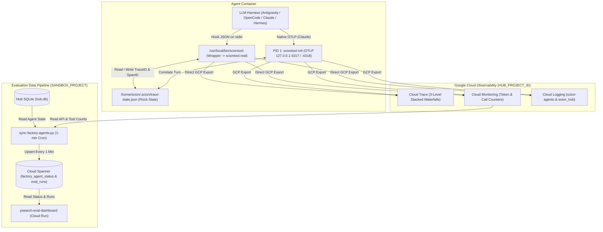

# Scion Telemetry and Evaluation Documentation (ASD-STE100)

This folder explains how telemetry, harness hooks, and evaluation data work in the Scion software factory.
All documents in this folder follow the **ASD-STE100** (Simplified Technical English) standard.

> [!IMPORTANT]
> Do not write secrets, tokens, or real project IDs in tracked files.
> Put your environment values in [`../scion/config/factory.env`](../scion/config/factory.env).

## Document Map

| Document | Topic |
|---|---|
| [reproduce-telemetry.md](reproduce-telemetry.md) | How to configure and verify Cloud Logging, Cloud Monitoring, and Cloud Trace |
| [eval-data-pipeline.md](eval-data-pipeline.md) | How the Hub and the evaluation runner send data to Cloud Spanner and the dashboard |
| [hooks-and-traces.md](hooks-and-traces.md) | How harness hooks, the `sciontool` wrapper, and stacked Cloud Trace waterfalls work |

## Architecture Overview

The telemetry system has three data paths:

## Quick Start (4 Steps)

Run these commands from [`docs/scion/`](../scion/) on your workstation:

1. Copy [`config/factory.env.example`](../scion/config/factory.env.example) to `config/factory.env` and set your project variables.
2. Run [`scripts/setup-telemetry.sh`](../scion/scripts/setup-telemetry.sh) to enable GCP APIs, create the service account, and configure the Hub VM.
3. Run [`scripts/patch-sciontool-telemetry.sh`](../scion/scripts/patch-sciontool-telemetry.sh) to install the telemetry wrapper in all containers and base images.
4. Run [`scripts/install-sync-cron.sh`](../scion/scripts/install-sync-cron.sh) to send agent telemetry and status to Cloud Spanner every minute.
