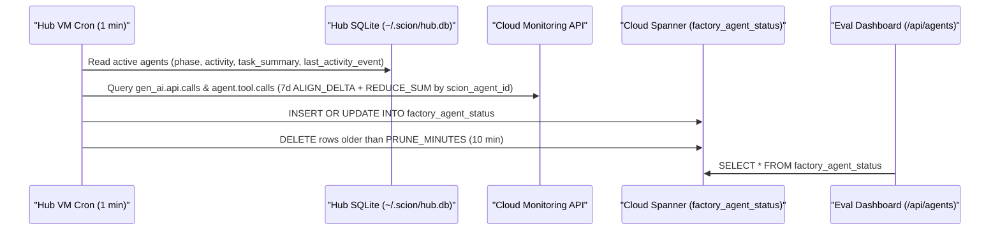

# How Telemetry and Evaluation Data Reach the Eval Dashboard

The evaluation dashboard (`psearch-eval-dashboard` on Cloud Run) reads data from two Cloud Spanner tables in `SANDBOX_PROJECT` ([`config/spanner-factory-ddl.sql`](../scion/config/spanner-factory-ddl.sql)):

1. **`factory_agent_status`**: Live agent state, activity, turn counts, and model call counts.
2. **`eval_runs`**: Product evaluation scores (L1–L5 pyramid), ranking metrics (`ndcg_at_10`, `mrr_at_10`), and latency percentiles (`p50_ms`, `p95_ms`, `p99_ms`).

---

## Pipeline 1: Live Agent State and Telemetry Sync (`factory_agent_status`)

The Hub VM runs [`scripts/sync-factory-agents.py`](../scion/scripts/sync-factory-agents.py) every minute from the `scion` user crontab.

### How `sync-factory-agents.py` Works



1. **Reads Hub SQLite state:**
   Opens `/home/scion/.scion/hub.db` in read-only mode (`mode=ro`) and selects all non-deleted agents in `BUILD_PROJECT` (`psearch`) and `EVAL_PROJECT` (`psearch-eval`).
2. **Reads Cloud Monitoring counters:**
   Queries the Cloud Monitoring API (`https://monitoring.googleapis.com/v3/projects/<HUB_PROJECT_ID>/timeSeries`) with `ALIGN_DELTA` and `REDUCE_SUM` grouped by `metric.label.scion_agent_id`:
   - `workload.googleapis.com/gen_ai.api.calls` populates `model_calls`.
   - `workload.googleapis.com/agent.tool.calls` populates `current_turns`.
3. **Writes to Cloud Spanner:**
   Executes `gcloud spanner databases execute-sql` against `SPANNER_DATABASE` in `SANDBOX_PROJECT` (with `--billing-project=$SANDBOX_PROJECT`):
   - Upserts one row per live agent into `factory_agent_status`.
   - Deletes rows where `updated_at` is older than `PRUNE_MINUTES` (10 minutes).

### How to Install or Update the Agent Sync Cron

Run these commands from [`docs/scion/`](../scion/):

1. Create the Spanner tables if they do not exist:
   ```bash
   ./scripts/setup-sandbox.sh --with-spanner
   ```
2. Install the 1-minute cron job on the Hub VM and run one sync immediately:
   ```bash
   ./scripts/install-sync-cron.sh --dry-run
   ./scripts/install-sync-cron.sh
   ```
3. Check the sync log on the Hub VM:
   ```bash
   ./scripts/run-on-hub.sh bash -c 'tail -n 20 ~/.scion/factory-sync.log'
   ```

---

## Pipeline 2: Product Evaluation Runs (`eval_runs`)

The evaluation service (`psearch-eval-dashboard`) and the evaluation agents (`search-evaluator`, `factory-analyst`, `eval-lead`) test the live product (`psearch-serving`) across the 5-layer evaluation pyramid ([`verification-and-eval.md`](../scion/verification-and-eval.md)):

1. **Synthetic Probes:**
   The evaluation runner sends golden search queries, filter combinations, autocomplete prefixes, and hybrid `alpha` weights (`0.0` to `1.0`) to `PSEARCH_SERVING_URL`.
2. **Metric Calculation:**
   The runner computes:
   - `overall_score`, `ndcg_at_10`, and `mrr_at_10`
   - Latency percentiles: `p50_ms`, `p95_ms`, and `p99_ms`
   - Requirement results and diagnostics in `requirements_json`
3. **Persistence in Cloud Spanner:**
   Each evaluation run writes one row to the `eval_runs` table in `SPANDBOX_PROJECT` (`SPANNER_DATABASE`) and records the tested `git_commit`.
4. **Dashboard API Endpoints:**
   - `GET /api/eval` returns the latest evaluation run, requirement checks, `alphaCurve`, and latency breakdown.
   - `GET /api/agents` reads `factory_agent_status` from Cloud Spanner and returns the live status of all 10 agents.
